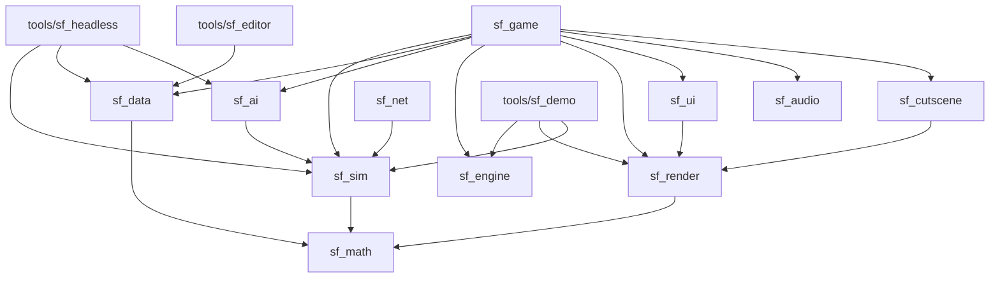

# Architecture

Source of truth: `PLAN.md` (§0, §1, §2, §3). This page summarizes it for agents
and humans. If this page and `PLAN.md` disagree, `PLAN.md` wins; fix this page.

## 1. Technology

Own thin engine on `wgpu` + `winit` (B1). No Bevy, no Fyrox. The world is true 3D
with a fixed camera angle and low-poly models (B2); gameplay is flat, on a 2D cell
grid. Components: `winit` (window/input), `wgpu` (GPU, instancing), `glam`
(render math, presentation only), own struct-of-arrays storage (simulation), `gltf`
(models), own UI on wgpu, `egui`/`egui-wgpu` (editor and debug UI only), `kira`
(audio), `serde` + `ron` (data), `ffmpeg` as a separate process (cartoon video
fallback), `proptest` + `insta` (tests). Target platforms v1: Windows + Linux (B7).

## 2. Crate map

| Crate / tool | Responsibility |
|---|---|
| `sf_math` | Fixed-point numbers, vectors, angles (256 directions), deterministic RNG. |
| `sf_sim` | The complete game simulation. No GPU, no I/O, no clock. |
| `sf_data` | Unit/building/weapon definitions (RON), validation, loading. |
| `sf_ai` | Computer opponent. Talks to `sf_sim` only via commands. |
| `sf_engine` | Main loop, window, input, time, assets. No game rules. |
| `sf_render` | wgpu: terrain, models, camera, zoom, effects, LOD. |
| `sf_ui` | Own UI: widgets, text, minimap; later sidebar, selection, menus. |
| `sf_audio` | Sound, voices, music. |
| `sf_cutscene` | Cartoon player and script format. |
| `sf_net` | Lockstep network (later, phase 14). |
| `sf_game` | Binary app that glues everything together. |
| `tools/sf_editor` | Map and mission editor. |
| `tools/sf_headless` | Simulation without a screen: tests, balance, AI-vs-AI. |
| `tools/sf_demo` | Engine demo and benchmark (phase 1). |

### Dependency directions

PLAN.md §1.1 fixes one hard rule (`sf_sim` never depends on `sf_render`) and
describes each crate's role. Dependency edges beyond that hard rule are
undecided (see PLAN.md §1.1). The diagram below is a non-binding sketch of the
edges that follow from the stated roles.



Binding rules:

1. **`sf_sim` never depends on `sf_render`** (or on any crate that depends on
   rendering, windowing, audio, network or the clock). The simulation must run
   thousands of ticks per second in `sf_headless` without a GPU.
2. `sf_ai` influences the world only through `Command`s to `sf_sim`.
3. Engine crates (`sf_engine`, `sf_render`, `sf_ui`, `sf_audio`) know no game
   rules: no "tank", no "ore"; only meshes, instances, entities, commands and
   checksums.
4. `sf_game` is the only place where everything is glued together.
5. Presentation-only libraries (`egui`, `kira`, `glam`, `ffmpeg`, `winit`, `wgpu`)
   stay out of `sf_sim`. `glam` is presentation only; the sim uses `sf_math`.

## 3. Simulation and presentation split (B3, §1.2)

- **Fixed step:** the simulation runs at 20 ticks/s, independent of rendering.
- **Commands:** input becomes a `Command` that is executed on tick N. The UI
  never mutates the world directly (quality rule 1).
- **Rendering** runs at the screen refresh rate and **interpolates** between the
  previous and the current tick.
- **Checksum:** every tick yields a checksum of the world state, used for desync
  detection and regression tests.
- **Determinism:** fixed-point math only, no floats, no hash-order iteration, no
  clock, no I/O in `sf_sim` (see `conventions.md`). This enables replays,
  saving, lockstep multiplayer and headless tests.

```
input -> Command(tick N) -> sf_sim tick (20 Hz) -> world state + checksum
                                   |
                       previous tick + current tick
                                   |
                     sf_render interpolates (refresh rate)
```

## 4. Entity storage

Game objects are entities in an **own struct-of-arrays storage with generation
IDs** (no ECS framework; PLAN.md §1.0). Columns hold position, owner, health,
mission, movement, weapon and so on. A fixed, predictable iteration order is what
gives determinism; the layout is cache-friendly and has no hidden scheduling.
Behavior per type comes from data (RON in `sf_data`), not from subclasses; this is
the modern translation of the object hierarchy in the analysis. The exact column
set and API are built in WP1.2 (undecided until then, see PLAN.md §3).

## 5. Coordinates (§1.3)

- Gameplay happens on a **cell grid** (for example 1 cell = 1 m; maps 64x64 up to
  256x256).
- Positions within a cell are fixed-point ("leptons", like the original).
- Height is **visual only**, plus a few gameplay effects (vision from a hill,
  slower uphill). No true 3D ballistics in v1.

## 6. Camera and zoom (summary of §2)

Perspective camera, fixed view direction (north up), logarithmic zoom toward the
cursor, angle follows zoom (about 45 degrees close up to about 80 degrees far
out). At strategic zoom units become screen-fixed icons in player color. Picking,
drag selection and commands work at every zoom level. Target: 60 fps with 1,000
units in view on the reference hardware (Windows laptop, GTX 1050, 1920x1080, B10);
first measurement at the engine demo (5,000 units), final measurement in phase 16.

## 7. Where the engine stops and the game begins

- **Phase 0 (foundation) and phase 1 (engine)** contain **no gameplay**. Engine
  crates handle meshes, instances, entities, commands, checksums, terrain,
  cameras, LOD, UI primitives, audio and the headless runner. The only sim
  behavior is a placeholder "wander".
- **Milestone M0** (engine demo, end of phase 1) must pass before any gameplay.
- **Phase 2 onward** adds game rules in `sf_sim` and `sf_data`: terrain types,
  units, commands, movement, combat, buildings, economy, vision, AI, missions.
  Game data lives in RON (quality rule 6), so adding a unit needs no Rust change.
- Milestones: M1 vertical slice (end of phase 7), M2 playable alpha (phase 15).

## 8. Where it is built

On GitHub only: cloud agents, GitHub Actions (Linux + Windows) and the Windows
laptop. Never on the home server (B6, PLAN.md §13).
