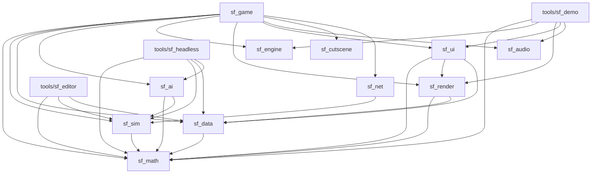

# Architecture

Source of truth: `PLAN.md` (§0, §1, §2, §3). This page summarizes it for agents
and humans. If this page and `PLAN.md` disagree, `PLAN.md` wins; fix this page.

## 1. Technology

Own thin engine on `wgpu` + `winit` (B1). No Bevy, no Fyrox. The world is true 3D
with a fixed camera angle and low-poly models (B2); gameplay is flat, on a 2D cell
grid. Components: `winit` (window/input), `wgpu` (GPU, instancing), `glam`
(render math, presentation only), own struct-of-arrays storage (simulation), `gltf`
(models), own UI on wgpu, `egui`/`egui-wgpu` (editor and debug UI only), `kira`
(audio), `serde` + `ron` (data), `ffmpeg` as a separate process (cartoon video
fallback), `proptest` + `insta` (tests). Target platforms v1: Windows + Linux (B7).

## 2. Crate map

| Crate / tool | Responsibility |
|---|---|
| `sf_math` | Fixed-point numbers, vectors, angles (256 directions), deterministic RNG. |
| `sf_sim` | The complete game simulation. No GPU, no I/O, no clock. |
| `sf_data` | Unit/building/weapon definitions (RON), validation, loading. |
| `sf_ai` | Computer opponent. Talks to `sf_sim` only via commands. |
| `sf_engine` | Main loop, window, input, time, assets. No game rules. |
| `sf_render` | wgpu: terrain, models, camera, zoom, effects, LOD. |
| `sf_ui` | Own UI: widgets, text, minimap; later sidebar, selection, menus. |
| `sf_audio` | Sound, voices, music; optional original Red Alert audio (`sf_audio::ra`, WP11.7). |
| `sf_cutscene` | Cartoon player and script format. |
| `sf_net` | Lockstep network (later, phase 14). |
| `sf_game` | Binary app that glues everything together. |
| `tools/sf_editor` | Map and mission editor. |
| `tools/sf_headless` | Simulation without a screen: tests, balance, AI-vs-AI. |
| `tools/sf_demo` | Engine demo and benchmark (phase 1). |

### Dependency directions

PLAN.md §1.1 fixes one hard rule (`sf_sim` never depends on `sf_render`) and
describes each crate's role. Dependency edges beyond that hard rule are
undecided (see PLAN.md §1.1). The diagram below is factual: it lists the
`path` dependencies between workspace crates in the `Cargo.toml` files, as of
WP1.11 (checked against every `Cargo.toml`). It will go stale as crates gain dependencies;
`cargo tree` is authoritative.



`sf_math`, `sf_engine`, `sf_audio` and `sf_cutscene` have no workspace dependencies yet.
(`sf_math` lists itself as a dev-dependency with its `render` feature, only so that
its own tests can use `render_bridge`; no other crate enables that feature yet.)

Rendering and windowing stay decoupled (WP1.4): `sf_engine` owns the `winit`
window and knows nothing about `wgpu`; `sf_render` owns `wgpu` and knows nothing
about `winit` or `sf_sim`. `sf_game` joins them: it hands the engine's window
(`Arc<winit::window::Window>`) to `Renderer::for_window`, which takes any
`wgpu::SurfaceTarget`. Headless rendering (`Renderer::headless`) needs no window
and is what the screenshot tests use.

Rules stated in PLAN.md:

1. **`sf_sim` does not depend on `sf_render`** (§1.1). The simulation must be able
   to run thousands of ticks per second in `sf_headless` without a GPU.
2. `sf_ai` talks to `sf_sim` only via commands (§1.1).
3. In phase 1 the engine crates know no game rules: no "tank", no "ore", only
   meshes, instances, entities, commands and checksums (§3, phase 1).
4. `glam` is used only in the presentation; the sim uses fixed-point (§1.0).

> **Proposal (not decided):** extend rule 1 to any crate that depends on
> rendering, windowing, audio, network or the clock; apply rule 3 to the named
> engine crates (`sf_engine`, `sf_render`, `sf_ui`, `sf_audio`); make `sf_game` the
> only crate that glues everything together; keep presentation libraries (`egui`,
> `kira`, `ffmpeg`, `winit`, `wgpu`) out of `sf_sim`.

## 3. Simulation and presentation split (B3, §1.2)

- **Fixed step:** the simulation runs at 20 ticks/s, independent of rendering.
- **Commands:** input becomes a `Command` that is executed on tick N. The UI
  never mutates the world directly (quality rule 1).
- **Rendering** runs at the screen refresh rate and **interpolates** between the
  previous and the current tick.
- **Checksum:** every tick yields a checksum of the world state, used for desync
  detection and regression tests.
- **Determinism:** fixed-point math only, no floats, no hash-order iteration, no
  clock, no I/O in `sf_sim` (see `conventions.md`). This enables replays,
  saving, lockstep multiplayer and headless tests.

```
input -> Command(tick N) -> sf_sim tick (20 Hz) -> world state + checksum
                                   |
                       previous tick + current tick
                                   |
                     sf_render interpolates (refresh rate)
```

## 4. Entity storage

Game objects are entities in an **own struct-of-arrays storage with generation
IDs** (no ECS framework; PLAN.md §1.0). Columns hold position, owner, health,
mission, movement, weapon and so on. A fixed, predictable iteration order is what
gives determinism; the layout is cache-friendly and has no hidden scheduling.
Behavior per type comes from data (RON in `sf_data`), not from subclasses; this is
the modern translation of the object hierarchy in the analysis.

As built in WP1.2 (`crates/sf_sim`; its crate documentation is the reference):

- **Columns:** generation, live flag, kind, owner, position and previous position,
  facing and previous facing, behavior, target, wander area and one PCG32 stream
  per entity. Health, mission, movement class and weapon columns arrive with their
  phases.
- **Ids:** `EntityId { index, generation }`. A stale id is simply not found.
- **Despawn:** the slot becomes a tombstone in place (no swap-remove), its
  generation goes up, its index goes on a LIFO free list. Iteration is always
  ascending slot index, so a despawn never reorders anything.
- **Tick:** `World::step()` runs exactly one 20 Hz tick: commands scheduled for
  that tick (ordered by player, then insertion; a past tick is rejected), then the
  behaviors, then the checksum.
- **Checksum:** FNV-1a over the full state in a canonical order after every tick,
  with the history kept for the headless runner. The previous position and facing
  (render interpolation only) are the one deliberate exclusion.
- **Presentation:** `World::snapshot()` is a read-only view with previous and
  current position and facing per live entity.
- **Floats:** `sf_math::render_bridge` sits behind sf_math's `render` cargo
  feature, which `sf_sim` never enables, so `cargo build -p sf_sim` cannot reach
  it. The presentation crates enable the feature when they need it.

## 5. Coordinates (§1.3)

- Gameplay happens on a **cell grid** (for example 1 cell = 1 m; maps 64x64 up to
  256x256).
- Positions within a cell are fixed-point ("leptons", like the original).
- Height is **visual only**, plus a few gameplay effects (vision from a hill,
  slower uphill). No true 3D ballistics in v1.

## 6. Camera and zoom (summary of §2)

Perspective camera, fixed view direction (north up), logarithmic zoom toward the
cursor, angle follows zoom (about 45 degrees close up to about 80 degrees far
out). At strategic zoom units become screen-fixed icons in player color. Picking,
drag selection and commands work at every zoom level. Target: 60 fps with 1,000
units in view on the reference hardware (Windows laptop, GTX 1650, 1920x1080, B10);
first measurement at the engine demo (5,000 units), final measurement in phase 16.

Implemented in `sf_render::camera` (WP1.5): zoom is a log-scale parameter in `0..=1`
mapped to the eye-to-focus distance 12 m .. just enough for the whole map (about
340 m for 256x256 m in a square window, computed from the map size and the
viewport aspect ratio, so a portrait window gets more distance); pitch is `smoothstep(zoom)`
between 45 and 80 degrees. The camera takes the frame time and a plain
`CameraInput` (pan direction, wheel notches, cursor, drag), so it is tested
without a window; `sf_game` maps the `Camera*` actions to that input. Cursor
guarantee: the ground point under the cursor stays under it (within 1 cm, tested)
on every damped frame of a wheel zoom and while dragging with the middle mouse
button; the only exception is the focus clamp at the map bounds (+16 m margin).
Q/E rotation is not implemented (the yaw is fixed, north up).

Relief (WP1.8): the camera works against a `Ground` (`sf_render::ground`): flat
by default, the terrain after `Camera::set_ground(TerrainGround)`. The point
under the cursor is the first hit of the cursor's ray with the terrain
triangles; zoom-to-cursor and the middle-mouse grab hold that 3D point under the
cursor with the same closed form as before, which works because the ray direction
depends only on the zoom: the eye lies on the line through the point along the
ray, and the pivot's height decides where on that line. The pivot height is
state (constant during a zoom or grab, easing toward the terrain under the focus
while panning, never drifting when idle), and the eye keeps `clearance` (2 m)
above the ground under it by raising the pivot, which slides the eye back along
the anchor ray, so the cursor guarantee also holds on relief (tested to 1 cm on
the generated map and on 18 m hills). A hill that moves in front of the point
while the camera sinks behind it hides it; then the point under the cursor is
the hill. Rays above the horizon have no ground point; a wheel step over the sky
zooms about the screen centre. Beyond the map the ground is the plane at the
lowest height of the map.

## 7. Where the engine stops and the game begins

- **Phase 0 (foundation) and phase 1 (engine)** contain **no gameplay**. Engine
  crates handle meshes, instances, entities, commands, checksums, terrain,
  cameras, LOD, UI primitives, audio and the headless runner. The only sim
  behavior is a placeholder "wander".
- **Milestone M0** (engine demo, end of phase 1) must pass before any gameplay.
- **Phase 2 onward** adds game rules in `sf_sim` and `sf_data`: terrain types,
  units, commands, movement, combat, buildings, economy, vision, AI, missions.
  Game data lives in RON (quality rule 6), so adding a unit needs no Rust change.
- Milestones: M1 vertical slice (end of phase 7), M2 playable alpha (phase 15).

## 8. Where it is built

On GitHub only: cloud agents, GitHub Actions (Linux + Windows) and the Windows
laptop. Never on the home server (B6, PLAN.md §13).

## 9. Terrain and the map format (WP1.7)

- **Format** (`sf_data::map`, no GPU or sim dependency, so `sf_headless` and the
  editor can read maps too): a directory `assets/maps/<name>/` with `map.ron`
  (width, height in cells, `height_scale` = metres at 65535, material names,
  file names), `height.png` (16-bit grayscale, (w+1) x (h+1) cell corners) and
  `materials.png` (8-bit grayscale, w x h, index into the material list). The
  loader checks sizes, bit depth, header ranges and material indices and
  reports a `MapError` naming the file. The format knows no game terrain
  types (phase 2). `sf_data::map::generate` is a seeded procedural generator;
  `cargo run -p sf_data --example gen_map -- <dir> [w] [h] [seed]` writes one.
- **Mesh** (`sf_render::terrain`): chunks of 32x32 cells, positions and
  central-difference normals from the global heightmap (so shared border
  vertices are bit-identical at equal levels), diagonals by global cell parity
  (`diagonal_nw_se`, the one triangulation that the mesh, the surface height and
  the picking share), one AABB per chunk (the same `Aabb` as the frustum code).
- **Materials:** one material per cell, kept as an `R8Uint` texture; the shader
  blends the four nearest cell centres and samples a `texture_2d_array` of
  procedural 128 px tileable textures (mipmapped, anisotropic) with world-space
  UVs (4 m per repeat). Lighting as in the scene shader.

### Terrain level of detail, seams and culling (WP1.8)

- **Levels:** every chunk has up to six meshes, level `l` using every `2^l`-th
  vertex of the full grid (steps of 1 to 32 cells; edge chunks smaller than 32
  only have the levels whose step divides their size). Each level stores its
  **exact geometric error** in metres, the largest vertical distance to the
  full-detail surface, found at the vertices of the common refinement of the two
  piecewise-linear surfaces (lattice points and the centres of the cells the
  coarse diagonal crosses; the coarse cell takes the diagonal with the smaller
  error). The errors never decrease with the level. Level normals are computed
  over the level's own step, like a mip chain.
- **Selection** (`sf_render::lod`, CPU only, tested without a GPU): a chunk takes
  the coarsest level whose projected error is at most `error_px` (2 px,
  `assets/config/terrain.ron`). A displacement of `e` metres moves a point at
  depth `z` and distance `d` by at most `e * focal_px * d / z^2` pixels (that is
  `e * focal_px / d` at the screen centre and 1.7 times more at a 1080p corner);
  `LodView::pixels_in_box` bounds it over the chunk's box, so the estimate holds
  anywhere on the screen. The eye, the view axis and the focal length are
  recovered from the view-projection, so the renderer needs nothing but
  `set_view_proj`. Hysteresis (25 %) keeps a chunk from flickering:
  it goes finer as soon as its error exceeds the budget but coarser only when
  the coarser level fits into 75 % of it.
- **Seams: skirts.** Neighbouring chunks at different levels meet along
  different polylines. Every chunk-level hangs a skirt under each edge that has a
  neighbour, down to the lowest full-detail height of that edge (minus 0.5 m).
  A level's surface along an edge is a polyline between heights of that edge, so
  it never dips below that minimum: the higher of the two skirts always reaches
  the lower surface, whatever the neighbour's level (tested for every pair of
  levels, and by rendering with the skirts off as the probe). Stitching was the
  alternative; skirts keep a chunk's mesh independent of its neighbours, which
  keeps selection, hysteresis and culling per chunk and the index data
  precomputed. The skirts face outward, so the one that hides a gap (the higher
  chunk's, seen from the lower side) is a front face: back-face culling stays on
  and the seam render test covers both viewing sides.
- **Culling and draw calls:** a chunk whose box is outside the frustum
  (`Frustum`, the code the instancing uses) is not drawn. All chunks and levels
  live in one vertex buffer and one `u32` index buffer, laid out level by level
  and chunk by chunk, so visible chunks with consecutive ids and the same level
  are one `draw_indexed`. Because hills make neighbours want different levels, the
  planner may also draw a chunk *finer* than its budget needs when that joins
  calls: it minimises triangles plus `draw_call_cost` (300) per call exactly
  (dynamic programming). Numbers, whole-map zoom: 256x256 map 12 draw calls; a
  1024x1024 map of hills 17 (495 without joining); a smooth 1024x1024 map 1.
- **Counters:** `Renderer::terrain_stats()` (`TerrainStats`: chunks total and
  visible, chunks per level, triangles, draw calls) and the same numbers in
  `DrawStats`.
- **Debug:** `TerrainConfig` (RON): `lod.force_level`, `seams: false` (shows the
  cracks); the tint by level is `DebugView::lod_tint`, the F1 panel's LOD switch
  (`lod::LOD_TINT`, `--debug-lod`); `Renderer::set_terrain_levels` fixes a level
  per chunk for tests. The draw counters are taken at the one `draw_indexed`
  site (`CountedPass`), terrain triangles included; chunks total/visible come
  from the planner.

### Picking (WP1.8)

`sf_render::ground`: the `Ground` trait (height at a point, first hit of a ray)
with `FlatGround` and `TerrainGround`. `TerrainGround` intersects the ray with
the very triangles of the full-detail mesh in `f64`: clip to the map footprint
and to the height range of the map, walk the cells front to back with a 2D DDA
and test a cell's two triangles only if the ray's height range over the cell
reaches the cell's corner heights. With the usual relief a camera ray crosses a
handful of cells. Coarser levels deviate from the picked surface by at most
their error, which is what the pixel budget allows. The camera, the units and
the click sound in `sf_game` use it.

## 10. Instancing (WP1.6)

- **Flow** (`sf_render::instancing`): once per sim tick the game turns each
  `sf_sim::EntityView` into a `Motion` (previous and current position and
  facing, converted to `f32` through `sf_math::render_bridge`, the only
  fixed-point to float path; `sf_render` stays free of `sf_sim`). Once per
  frame `Instancer::build(frustum, alpha, ground)` culls, interpolates
  `lerp(prev, current, alpha)` (facing along the shortest arc of the 256
  steps, so 255 to 1 passes through 0), puts each unit on the terrain height
  (display only; the sim stays 2D) and fills one instance list per mesh kind.
  `Renderer::set_instances(kind, list)` keeps one growing instance buffer per
  mesh kind: one draw call per kind. Since WP1.9 the game calls
  `Instancer::build_frame` (levels of detail, icons, picking; §14) and the lists
  are per (mesh kind, level of detail); `build` is the level-0 models-only case.
- **Culling:** entities are bucketed by map tile (32 m, the terrain chunk
  size) with a counting sort at tick time. A tile's box is the box around the
  previous and current positions of its members, grown by the largest shape
  footprint, with the terrain's height range plus the tallest shape as its
  vertical extent; tiles outside the frustum (`Frustum::classify`, planes from
  the view-projection) are skipped. Interpolated positions stay between the
  two ticks, so nothing visible is dropped. Culling is per tile, not per unit.
- **Look as data:** `assets/config/units.ron` holds the player palette (sRGB,
  four colors) and the placeholder shapes (cube, cylinder, cone, with sizes).
  Until units are data-driven (phase 2), `sf_game` uses entity kind modulo the
  number of shapes and owner modulo the number of colors. Debug builds reload
  it when it changes on disk (`Instancer::set_style`, WP1.11); a broken file is
  reported and the old look stays.
- **Counters** for the debug panel: `InstanceStats` (total, visible, tiles,
  per mesh kind, visible and total) from `Instancer::build` and `DrawStats`
  (instances and draw calls: dynamic, static scene, terrain) from
  `Renderer::draw_stats`. `DrawStats` is counted at the `draw_indexed` calls
  of the last rendered frame, not derived from instance counts.

## 11. Headless runner (WP1.3)

`tools/sf_headless` (library plus binary; its crate documentation is the
reference) runs a scenario file on `sf_sim` with no window and no GPU:

```
sf_headless <scenario.ron> [--ticks N] [--every K] [--out log.json] [--expect HEX]
```

- **Scenario** (`assets/scenarios/*.ron`): world seed, map size, run length,
  spawn groups (count, kinds and owners cycled, area) and an optional list of
  timed commands (`SetWanderArea`, `MoveTo`, `Despawn`, entities named by id).
  Unknown fields and scenarios that cannot run (`ticks: 0`, a command after the
  last tick, an area outside the map, ...) are reported with the file name and every
  problem found. Everything is scheduled before tick 0, like a replay; the spawn
  positions come from their own PCG32 stream seeded with the world seed, so
  `wander_5000.ron` is the same crowd as the sf_sim golden scenario.
- **Log** (`--out`): flat JSON, written by hand with a fixed layout: scenario, seed,
  tick and command counts, initial and final checksum, the checksum after every
  K-th tick, then a `host` block (OS, architecture, wall time, ticks/s). Everything
  before `host` is deterministic; wall time is measured around the run in `cli.rs`
  and never reaches `sf_sim`.
- **Exit codes:** 0 ok, 1 `--expect` mismatch, 2 usage error, invalid scenario or
  unwritable log.
- **CI:** the `headless` job runs `wander_5000` (10,000 ticks, 5,000 wanderers) and
  `command_mix` in release mode on Linux and Windows against the committed
  `<name>.expected` values and uploads the logs; `headless-compare` fails if the
  two sets differ in anything but `host` (`scripts/compare-headless-logs.sh`).

## 12. Debug panels (WP1.11)

F1 (action `ToggleDebug` in `assets/config/input.ron`) toggles two egui
windows: *Performance* (frame time graph of the last 300 frames with avg / p99 /
max, draw calls and instances per mesh kind, terrain chunks drawn, sim tick and
checksum in hex) and *Camera & view* (the live `CameraConfig` tunables: zoom
step per notch, zoom and pan damping, pan speed, near and far pitch, reset; the
LOD colouring and cell grid toggles). Off by default (`--debug-ui` opens it for
screenshots; `--debug-grid` and `--debug-lod` preset the toggles).

**Layers and dependency edges** (external crates, which the mermaid graph above
does not list):

| Crate | Depends on | Does |
|---|---|---|
| `sf_render` | `egui`, `egui-wgpu` | Paints: `OverlayFrame` (tessellated jobs + texture deltas) in a second render pass over the scene, on its own wgpu device. Knows no panels and no winit. |
| `sf_engine` | (no egui) | `App::on_window_event` offers each raw window event to the app before the engine's own input state sees it. `true` = consumed: presses and wheel notches are withheld from `InputState`; releases and cursor moves always pass, so nothing sticks. |
| `sf_game` | `egui`, `egui-winit` | `debug_ui`: builds the panels from plain data (`PanelData`, `PanelState`) and feeds events through `egui_winit::State`. The only place that knows both egui and the game. |

Versions: `egui`, `egui-wgpu` and `egui-winit` 0.36.2 (0.36.x is the first line
whose `egui-wgpu` requires wgpu 30; `egui-winit` requires winit 0.30.13, as
`sf_engine` does). Default features are off (no clipboard, no link opening).

**Input order.** While the panels are open, egui sees every window event first
(`DebugUi::on_event`); what it consumes (pointer over a panel or a slider held,
text field focused) never reaches the camera. A held slider also suppresses
screen-edge panning. While hidden no event is forwarded.

**Free while off.** Hidden panels run no egui pass, forward no events and the
renderer records no overlay pass; the egui painter and winit state are created
on the first show. Closing clears the overlay jobs.

**Terrain views** (`Renderer::set_debug_view`, `DebugView`): a flag and an
opacity in the terrain uniform. The grid is 1 m lines in the terrain fragment
shader, anti-aliased with `fwidth`, fading out when lines get closer than ~2 px
and with the camera distance (`DebugView::grid_alpha_for_distance`: full up to
40 m, gone at 140 m); chunk borders (32 m) are heavier and yellow. **LOD
colouring** (WP1.8) tints every terrain chunk by its real level of detail: each
terrain vertex carries the level of its mesh, the shader mixes in
`lod_tint(level)` (red = full detail, then orange, yellow, green, blue, purple;
`lod::LOD_TINT`) when the flag is set. The panel shows the chunks drawn, the
triangles and the number of chunks per level (`DrawStats`).

**Camera tunables** are applied by rebuilding the `Camera` from the edited
config (`Camera::with_config`: same focus, pivot height, zoom, viewport and
ground, so picking stays on the terrain; the velocity resets). Saving the
tuned values to RON is not done yet.

## 13. Player-facing UI (WP1.12)

`sf_ui` is the in-game UI; `egui` stays for debug panels and tools. Details are in
the crate docs (`crates/sf_ui/src/lib.rs`); the decisions:

- **Immediate mode.** `Ui::begin_frame`, widgets in painter's order (`panel`,
  `text_in`, `button`, `area`, `minimap`), `Ui::end_frame`. A button's `clicked` is
  the return value of the call that declares it. The UI never touches the world;
  the game turns responses into commands.
- **One pipeline, two draw calls.** Every primitive is a tinted textured quad
  (`DrawList`). Solid rectangles, glyph coverage and the procedural nine-slice skin
  share one dynamically packed atlas (`Atlas`, shelf packer, grows in height); the
  baked minimap is the second texture. `UiRenderer::render` records one render pass
  on top of the scene through `Renderer::render_with` (the only `sf_render` change:
  a closure hook that receives the frame's encoder and colour view; the egui overlay
  of WP1.11 can use the same hook).
- **Layout and scale.** Nine anchors plus an inward offset relative to the window or
  another rectangle; sizes in logical pixels times the effective scale (`ui.ron`
  `scale` times the window's DPI factor), snapped to whole pixels.
- **Input first.** A press of any mouse button or a wheel notch over a panel, button
  or area is consumed; a button pressed on the UI stays captured until released, so a
  drag never leaks; releases always reach the game. `Ui::filter_for_game` applies the
  rule to a raw `UiInput`; `Ui::blocks_pointer_at` answers from the last frame's
  rectangles for an event hook (`App::on_window_event` of WP1.11).
- **Minimap.** The terrain is baked once on the CPU (material average colour times
  slope shading) and uploaded as a texture; unit dots and the field-of-view frame
  (the four screen corners projected on the ground with `Camera::ground_point`,
  which since WP1.8 is a terrain pick, clamped to the map) are drawn per frame; a left press or drag returns the world
  point for `Camera::set_focus`.

## 14. Model LOD, strategic icons and picking (WP1.9)

PLAN.md §2.2 and §2.3 in code. Three CPU modules in `sf_render` (`model`, `icons`,
`pick`; the crate docs are the reference), `Instancer::build_frame` and `pick` in
`instancing`, the icon pass in `renderer` and `assets/shaders/icon.wgsl`.

- **LOD chain per model** (`model.rs`). A shape has 1 to 4 levels, finest first;
  level `i` is used while the model's *projected size* (bounding diameter times
  `focal_px / distance`, physical pixels, so not scaled by the UI scale) is at
  least `switch_px[i]`, the last level takes the rest. Selected **per instance
  per frame** with hysteresis (`ModelLods::select`: coarser only when below
  `switch * (1 - h)`, finer only when above `switch * (1 + h)`; the level of
  each entity slot is kept in one byte, so it survives other units despawning).
  The chain is data (`units.ron`, `lods: [(segments: Some(16), min_px: 60.0), ...]`);
  the cube has one level, the cylinder and cone 16 / 8 / 5 facets
  (`MeshData::cylinder_with`, `cone_with`).
- **One draw per (mesh kind, level).** Meshes live in one table addressed by
  `MeshId`: the five `MeshKind`s first (a kind is its own id), then the extra
  meshes of `ModelSet::extra_meshes`. The instancer keeps one list per id, the
  renderer one buffer and one draw per list (`Renderer::upload_units` registers the
  extra meshes when `ModelSet::revision` changes, then uploads every list and the
  icons). Three shapes with 1 + 3 + 3 levels make at most 7 model draws.
  **For WP1.10:** load the glTF meshes, hand them to `ModelSet::new(extra, chains)`
  with the asset's switch sizes and `Instancer::set_models`; selection, stats and
  picking need no change. A level is one mesh today; a hull/turret model would add
  a part list to `LodLevel`.
- **When icons take over** (`icons.rs`, `icons:` in `units.ron`). The trigger is the
  apparent size, at the camera focus, of a reference unit (`reference_size` 2 m):
  `reference_size * focal_px / camera distance`. Models only at or above
  `model_above_px` (28), icons only at or below `icon_below_px` (14), a cross-fade
  in between that is linear in the *logarithm* of that size (so a wheel notch moves
  it equally everywhere in the band). It is one number per frame, not per unit, so
  all units cross over together, and it is in pixels, not in camera zoom (zoom 1.0
  is 340 m on a 256 m map and 1360 m on a 1024 m map), so it means the same on every
  map and resolution. The thresholds are logical pixels times the UI scale, like the
  icon. The F1 panel shows the band as camera distances.
- **Icons.** One instanced quad per unit, one draw call (`IconInstance`, 32 bytes:
  world anchor, shape + flags, colour). The vertex shader projects the anchor and
  lays a quad of `size_px * ui_scale` **pixels** around it (centre snapped to the
  pixel grid so edges are crisp), so the size is the same at every zoom. The shape
  (square, circle, triangle: `icon:` per shape) is a signed distance function in the
  fragment shader, so it is crisp at every scale; fill = player colour (unlit, so it
  is exactly the palette colour), dark outline, white when highlighted.
- **The cross-fade is a dissolve, not alpha.** The blend is one number, the model
  weight `m`; the icon weight is `1 - m` (the sum is exact by construction). Both
  representations compare the pixel's 8x8 Bayer threshold with the same `m` (the
  alpha of the instance colour): the model keeps the pixels with threshold `< m`
  (`scene.wgsl`), the icon draws the others (`icon.wgsl`). Every pixel belongs to
  exactly one of them: **no double-bright overlap, no dark dip from two
  half-transparent layers, nothing to sort** (the models stay opaque and
  depth-correct), nothing pops (at `m = 1` the test passes everywhere, at `m = 0` the
  models are not even built). The price is a visible screen-door pattern for the
  second or so of a zoom through the band. The icon's own antialiased edge is plain
  alpha blending on top. Weight 1 skips the test in the shader.
- **Icons are not depth tested** (documented choice). They are a map symbol drawn
  after the scene, over terrain and models. A depth-tested billboard would be half
  eaten by the ground below it on a tilted camera (the ground lower on the screen is
  nearer the eye than the icon's anchor), and a symbol hidden by a hill is a unit
  the player cannot find; at the zoom where icons exist the camera is 70 degrees or
  more down and relief hides almost nothing. What a player may know about enemy
  units is the fog of war's business (WP8.4), not the depth buffer's. Consequence:
  icons on both sides of a ridge overlap without occluding.
- **Picking per zoom** (`pick.rs`; `Instancer::pick(&PickQuery)` answers from the
  records of the last `build_frame`, i.e. exactly what was drawn: the interpolated
  position and facing and the terrain height of that frame).
  * Models: the cursor ray against the model's oriented box (`ray_obb`), enlarged
    so that its footprint is at least `click_min_px` (14, times the UI scale) wide on
    the screen. The nearest hit along the ray wins. **Terrain occlusion:**
    `PickQuery::with_ground(&Ground)` takes the exact ray-terrain hit of WP1.8 and a
    model entered behind it is hidden by the hill.
  * Icons: the cursor inside the icon's snapped screen quad, boundary inclusive
    (`icon_hit`). Terrain does not hide icons (they are not depth tested). The icon
    whose centre is nearest the cursor wins, then the nearer to the camera, then the
    lower id.
  * Cross-fade band: the representation with the larger weight, the model on a tie.
  * Tile pruning: a tile is searched only if the cursor ray passes its box grown by
    what a click volume can grow; 0.01 ms for 10,000 icons.
- **Hover** (`sf_game`): `build_frame`, `pick`, `Instancer::highlight` (model tinted
  towards white, icon gets a white outline), `Renderer::upload_units`. The F1 panel
  names the unit and shows the level counts, the blend and the band; "Units" radio:
  by zoom / models / icons. A click does nothing yet. `--hover x,y` fixes the cursor
  for screenshots, `--unit-display` sets the radio.
- **Counters:** `InstanceStats` (`per_lod`, `models`, `icons`, `model_triangles`,
  `model_draw_calls`, `icon_draw_calls`); `DrawStats` (`dynamic_triangles`,
  `icon_instances`, `icon_draw_calls`), counted in `CountedPass::draw` like the rest.
  Models of a single-level shape count as level 0.
- **Not hot-reloaded:** `icon.wgsl` (the scene shader is). `units.ron` is, in debug
  builds, and rebuilds the model set.

## 15. Original Red Alert audio (WP11.7, B11)

**Where.** A module `sf_audio::ra`, not a separate crate: it only feeds
decoded PCM into the existing kira player (`Player::inject`) and has no user
outside `sf_audio` and the F1 sound browser in `sf_game`. Split it out only if
a tool (an extractor, the editor) ever needs the readers without kira.

**What.** `ra::mix` reads MIX archives (TD header, Red Alert plain and
encrypted headers, nested archives, lookup by the file-name hash),
`ra::crypto` does the RSA + Blowfish step of encrypted headers, `ra::aud`
decodes AUD (Westwood ADPCM and IMA ADPCM, mono/stereo, 8/16-bit) to PCM.
`ra::scan` lists everything under the configured path (the sound browser),
`ra::load` also decodes the sounds named in `assets/audio/ra_mapping.ron`.
`AudioSystem::enable_original_audio` runs `load` on a background thread;
`update()` picks the result up, after which a mapped event plays the Red Alert
sound (with the bank entry's volume and category when it has one) and every
other event its CC0 sound. Nothing found, or anything broken: one warning,
the CC0 sounds keep playing; no reader panics (a fuzz-style test feeds random
and mutated input), and a scan visits each archive region once and stops at
fixed caps on archives, entries and decoded bytes.

**Clean-room (B5).** Written only from public format descriptions, never from
the EA source release or OpenRA (both GPL), and without following the code
links some of these pages carry:
- ModdingWiki, "MIX Format (Westwood)": <https://moddingwiki.shikadi.net/wiki/MIX_Format_(Westwood)>
  (header layouts, flags, entry table, the encrypted-header scheme: two
  40-byte little-endian RSA blocks, exponent 0x10001, a 56-byte key for
  Blowfish in ECB mode, and Westwood's published public key);
- ModdingWiki, "Westwood AUD Format": <https://moddingwiki.shikadi.net/wiki/Westwood_AUD_Format>
  (header, chunk layout, compression codes);
- MultimediaWiki, "Westwood ADPCM Audio": <https://wiki.multimedia.cx/index.php/Westwood_ADPCM_Audio>
  (based on Valery V. Anisimovsky's WS-AUD notes: Westwood ADPCM codes,
  tables, per-chunk 0x80 start, raw chunks, 5-bit delta, `LL RR` stereo IMA
  layout in VQA sound);
- MultimediaWiki, "Westwood IMA ADPCM": <https://wiki.multimedia.cx/index.php/Westwood_IMA_ADPCM>
  (predictor and index start at 0 and carry across chunks, stereo `L1L0 R1R0`);
- IMA "Recommended Practices for Enhancing Digital Audio Compatibility in
  Multimedia Systems" (1992): IMA ADPCM tables;
- Blowfish: B. Schneier (1993) and his published test vectors, via the
  RustCrypto `blowfish` crate unchanged; RSA: plain modular exponentiation
  (`num-bigint`).

The file-name hash (rotate left by one, add the next four bytes) is not
described on these pages ("a rolling hash" only); it is implemented from the
author's general knowledge of the format and is unverified. **Decision Tijmen
17-10-2026:** accepted as a format fact under B5. It is the only way to find a
name in a MIX index, so it is dictated by interoperability; no non-GPL
description of it was reachable; the Rust code is our own and not a translation
of EA or OpenRA code. Replace the source note if a non-GPL description turns up.

**WAV folders and `sf_ra_extract` (17-10-2026).** `tools/sf_ra_extract`
turns the player's own Red Alert CD image (`.iso`), disc/install directory or
`.mix` into `<out>/<archive>/<name or #id>.wav` (16-bit PCM, `ra::wav`), using
the `ra` readers and caps above plus its own ISO 9660 reader written from
ECMA-119 (primary volume descriptor, directory records, file extents; no
Joliet/Rock Ridge; bounded depth, record count and directory size; each
directory extent once). Audio only: entries starting `FORM....WVQA` and loose
`.vqa` files are counted and skipped, their sound is never decoded (decision
Tijmen). No Red Alert name list is shipped (no public non-GPL list was
found); names come from a player-supplied `--names` file hashed with
`mix_id`, otherwise `#XXXXXXXX`. The tool refuses an output folder below a
`.git` (B11). On the game side `ra::scan` lists every directory with `.wav`
files as an archive "<dir> (WAV folder)" (`EntryKind::Wav`), `wav_name` maps
`CLICK.wav` to `CLICK.AUD` and `#1A2B3C4D.wav` to that id, and
`Catalog::find` prefers a WAV entry over a MIX entry.

**Not verified against real files** (the repo and CI never have any): standard
(big-endian word) Blowfish on the header bytes, the file-name hash, and IMA
chunk carry-over and stereo layout (described for VQA/Westwood IMA, applied to
AUD as well); a mismatch shows up as a decode error in the sound browser, not
as a crash. Tests build their own fixtures (own ADPCM encoders, own MIX
writer, an own multi-prime RSA test key).
