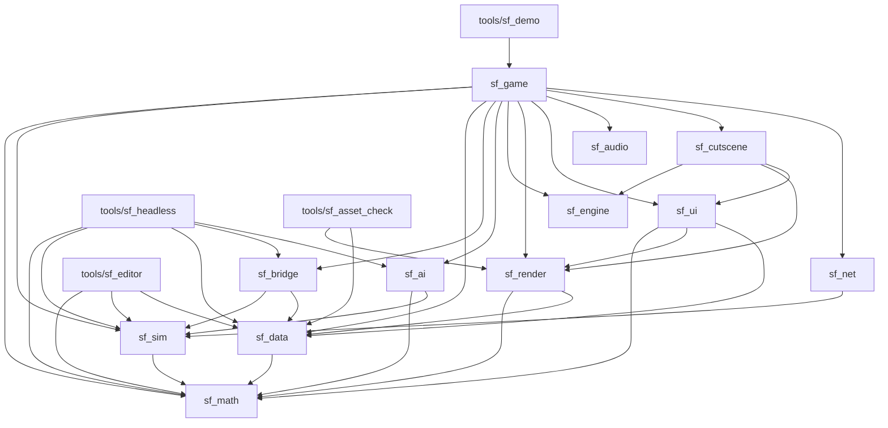

# Architecture

Source of truth: `PLAN.md` (§0, §1, §2, §3). This page summarizes it for agents
and humans. If this page and `PLAN.md` disagree, `PLAN.md` wins; fix this page.

## 1. Technology

Own thin engine on `wgpu` + `winit` (B1). No Bevy, no Fyrox. The world is true 3D
with a fixed camera angle and low-poly models (B2); gameplay is flat, on a 2D cell
grid. Components: `winit` (window/input), `wgpu` (GPU, instancing), `glam`
(render math, presentation only), own struct-of-arrays storage (simulation), `gltf`
(models), own UI on wgpu, `egui`/`egui-wgpu` (editor and debug UI only), `kira`
(audio), `serde` + `ron` (data), `proptest` + `insta` (tests). The cartoon video
fallback is deferred (WP12.4; stack in PLAN §1.0). Target platforms v1: Windows + Linux (B7).

## 2. Crate map

| Crate / tool | Responsibility |
|---|---|
| `sf_math` | Fixed-point numbers, vectors, angles (256 directions), deterministic RNG. |
| `sf_sim` | The complete game simulation. No GPU, no I/O, no clock. |
| `sf_data` | Unit/building/weapon definitions (RON), validation, loading. |
| `sf_bridge` | Copies the unit definitions of `sf_data` into the unit table of `sf_sim` (WP3.2): the one place that sees both, shared by `sf_game` and `sf_headless`. |
| `sf_ai` | Computer opponent. Talks to `sf_sim` only via commands. |
| `sf_engine` | Main loop, window, input, time, assets. No game rules. |
| `sf_render` | wgpu: terrain, models, camera, zoom, effects, LOD. |
| `sf_ui` | Own UI: widgets, text, minimap; later sidebar, selection, menus. |
| `sf_audio` | Sound, voices, music; optional original Red Alert audio (`sf_audio::ra`, WP11.7). |
| `sf_cutscene` | Cartoon player and script format. The RON scene format, its loader/validator, the render-free `Scene::sample` and the Fountain importer (WP12.1), the player state machine, the wgpu renderer on top of the engine renderer's frame hook, the `play_scene` viewer (WP12.2), and the live preview `play_scene --watch` (WP12.6: polling file watcher, reload state machine, writer HUD); `docs/cutscene-format.md`. |
| `sf_net` | Lockstep network (later, phase 14). |
| `sf_game` | The game shell: a library (window loop, camera, HUD, F1 panels, the benchmark) and the development viewer binary. |
| `tools/sf_editor` | Map and mission editor. |
| `tools/sf_headless` | Simulation without a screen: tests, balance, AI-vs-AI. |
| `tools/sf_demo` | Engine demo and benchmark of milestone M0 (phase 1): the `sf_game` library with the demo's defaults. |
| `tools/sf_asset_check` | Checks delivered `.glb` models against the art brief (LODs, budgets, materials, team colour, bounds, node names); see section 15. |
| `tools/sf_icon_gen` | Writes the placeholder strategic icons (`assets/icons/*.png`, `icons.ron`) deterministically (WP3.6); depends on nothing but the `png` crate. `docs/rules/icons.md`. |

### Dependency directions

PLAN.md §1.1 fixes one hard rule (`sf_sim` never depends on `sf_render`) and
describes each crate's role. Dependency edges beyond that hard rule are
undecided (see PLAN.md §1.1). The diagram below is factual: it lists the
`path` dependencies between workspace crates in the `Cargo.toml` files, as of
WP1.11 (checked against every `Cargo.toml`). It will go stale as crates gain dependencies;
`cargo tree` is authoritative.



`sf_math`, `sf_engine` and `sf_audio` have no workspace dependencies yet. `sf_cutscene` (WP12.2)
depends on `sf_render` (the frame hook, the PNG reader), `sf_ui` (the font and glyph atlas) and
`sf_engine` (only for the `play_scene` window); it never depends on `sf_audio`: sound leaves the
player through a trait.
(`sf_math` lists itself as a dev-dependency with its `render` feature, only so that
its own tests can use `render_bridge`; no other crate enables that feature yet.)

Rendering and windowing stay decoupled (WP1.4): `sf_engine` owns the `winit`
window and knows nothing about `wgpu`; `sf_render` owns `wgpu` and knows nothing
about `winit` or `sf_sim`. `sf_game` joins them: it hands the engine's window
(`Arc<winit::window::Window>`) to `Renderer::for_window`, which takes any
`wgpu::SurfaceTarget`. Headless rendering (`Renderer::headless`) needs no window
and is what the screenshot tests use.

Rules stated in PLAN.md:

1. **`sf_sim` does not depend on `sf_render`** (§1.1). The simulation must be able
   to run thousands of ticks per second in `sf_headless` without a GPU.
2. `sf_ai` talks to `sf_sim` only via commands (§1.1).
3. In phase 1 the engine crates know no game rules: no "tank", no "ore", only
   meshes, instances, entities, commands and checksums (§3, phase 1).
4. `glam` is used only in the presentation; the sim uses fixed-point (§1.0).

> **Proposal (not decided):** extend rule 1 to any crate that depends on
> rendering, windowing, audio, network or the clock; apply rule 3 to the named
> engine crates (`sf_engine`, `sf_render`, `sf_ui`, `sf_audio`); make `sf_game` the
> only crate that glues everything together; keep presentation libraries (`egui`,
> `kira`, `winit`, `wgpu`) out of `sf_sim`.

## 3. Simulation and presentation split (B3, §1.2)

- **Fixed step:** the simulation runs at 20 ticks/s, independent of rendering.
- **Commands:** input becomes a `Command` that is executed on tick N. The UI
  never mutates the world directly (quality rule 1).
- **Rendering** runs at the screen refresh rate and **interpolates** between the
  previous and the current tick.
- **Checksum:** every tick yields a checksum of the world state, used for desync
  detection and regression tests.
- **Determinism:** fixed-point math only, no floats, no hash-order iteration, no
  clock, no I/O in `sf_sim` (see `conventions.md`). This enables replays,
  saving, lockstep multiplayer and headless tests.

```
input -> Command(tick N) -> sf_sim tick (20 Hz) -> world state + checksum
                                   |
                       previous tick + current tick
                                   |
                     sf_render interpolates (refresh rate)
```

In the game the middle of this picture is a thread of its own since WP1.15:
the world is stepped on the sim thread and the rest reads the snapshot it
publishes (section 18). `sf_headless` and the tests call `World::step`
directly and stay single-threaded.

## 4. Entity storage

Game objects are entities in an **own struct-of-arrays storage with generation
IDs** (no ECS framework; PLAN.md §1.0). Columns hold position, owner, health,
mission, movement, weapon and so on. A fixed, predictable iteration order is what
gives determinism; the layout is cache-friendly and has no hidden scheduling.
Behavior per type comes from data (RON in `sf_data`), not from subclasses; this is
the modern translation of the object hierarchy in the analysis.

As built in WP1.2 (`crates/sf_sim`; its crate documentation is the reference):

- **Columns:** generation, live flag, kind, owner, position and previous position,
  facing and previous facing, behavior, target, wander area and one PCG32 stream
  per entity. Health, mission, movement class and weapon columns arrive with their
  phases.
- **Ids:** `EntityId { index, generation }`. A stale id is simply not found.
- **Despawn:** the slot becomes a tombstone in place (no swap-remove), its
  generation goes up, its index goes on a LIFO free list. Iteration is always
  ascending slot index, so a despawn never reorders anything.
- **Tick:** `World::step()` runs exactly one 20 Hz tick: commands scheduled for
  that tick (ordered by `(player, player sequence)`: a player's own counter, or the
  number its sender gave the command; a past tick is rejected), then the behaviors,
  then the checksum.
- **Orders (WP3.4):** a unit has a current order and a fixed ring of queued ones
  (`sf_sim::orders`, `docs/rules/orders.md`); `Command::Order` and `Command::Stop` set
  them, the behavior pass carries them out. The order holds the destination; the route is a
  separate record of the unit (WP4.2, `sf_sim::path`, `docs/rules/pathfinding.md`): hierarchical
  A* over 16 x 16 cell sectors and their portals, served inside a node budget per tick,
  going round the entity ids, followed as a ring of waypoints.
- **Checksum:** FNV-1a over the full state in a canonical order after every tick,
  with the history kept for the headless runner. The previous position and facing
  (render interpolation only) are the one deliberate exclusion.
- **Terrain and occupancy (WP2.1):** a terrain type and an occupant per cell, in
  arrays sized by the map; `Command::Place` is the one way to occupy a cell, so
  occupancy changes only in the tick. Their checksum sections exist only when they
  have content, which keeps every older checksum as it was (`sf_sim::checksum`).
- **Presentation:** `World::snapshot()` is a read-only view with previous and
  current position and facing per live entity.
- **Floats:** `sf_math::render_bridge` sits behind sf_math's `render` cargo
  feature, which `sf_sim` never enables, so `cargo build -p sf_sim` cannot reach
  it. The presentation crates enable the feature when they need it.

## 5. Coordinates (§1.3)

- **Engine axes** (fixed in WP1.10, `docs/conventions.md` section 12): metres,
  `+Y` up, the front of a model along `+X`, the ground at `Y = 0`, right-handed (a
  model's right side is `+Z`). The sim's 2D `(x, y)` is the render `(x, z)`;
  facing 0 is `+X` and turns towards `+Z`.

- Gameplay happens on a **cell grid of 4 m cells** (B12; maps 64x64 up to
  256x256 cells, so 256 m up to 1,024 m). The visual terrain keeps its 1 m
  resolution: four terrain samples along every cell side.
- Positions within a cell are fixed-point ("leptons", like the original).
- **One scale constant at the boundary.** `sf_sim` positions are in cells
  (`Fx::ONE` = 1 cell) and never see a metre. `sf_math::CELL_METRES` (4) is the
  only place the scale lives; the presentation applies it where the sim's
  numbers enter the renderer: `render_bridge::vec2_cells_to_metres` (used by
  `Motion::from_fixed`, the minimap dots and the camera/audio focus) and back
  with `render_bridge::vec2_metres_to_cells` for a picked ground point that
  becomes a command. The map size handed to the sim is
  `Map::size_in_cells()`, the camera, the instancer and the terrain take metres
  (`Map::width()`). Because the sim never reads the constant, the checksums
  (headless goldens, `wander_5000.expected`) do not change when it does.
- Height is **visual only**, plus a few gameplay effects (vision from a hill,
  slower uphill). No true 3D ballistics in v1.

## 6. Camera and zoom (summary of §2)

Perspective camera, fixed view direction (north up), logarithmic zoom toward the
cursor, angle follows zoom (about 45 degrees close up to about 80 degrees far
out). At strategic zoom units become screen-fixed icons in player color. Picking,
drag selection and commands work at every zoom level. Target: 60 fps with 1,000
units in view on the reference hardware (Windows laptop, GTX 1650, 1920x1080, B10);
first measurement at the engine demo (5,000 units), final measurement in phase 16.

Implemented in `sf_render::camera` (WP1.5): zoom is a log-scale parameter in `0..=1`
mapped to the eye-to-focus distance 12 m .. just enough for the whole map (about
340 m for 256x256 m in a square window, computed from the map size and the
viewport aspect ratio, so a portrait window gets more distance); pitch is `smoothstep(zoom)`
between 45 and 80 degrees. The camera takes the frame time and a plain
`CameraInput` (pan direction, wheel notches, cursor, drag), so it is tested
without a window; `sf_game` maps the `Camera*` actions to that input. Cursor
guarantee: the ground point under the cursor stays under it (within 1 cm, tested)
on every damped frame of a wheel zoom and while dragging with the middle mouse
button; the only exception is the focus clamp at the map bounds (+16 m margin).
Q/E rotation is not implemented (the yaw is fixed, north up).

Relief (WP1.8): the camera works against a `Ground` (`sf_render::ground`): flat
by default, the terrain after `Camera::set_ground(TerrainGround)`. The point
under the cursor is the first hit of the cursor's ray with the terrain
triangles; zoom-to-cursor and the middle-mouse grab hold that 3D point under the
cursor with the same closed form as before, which works because the ray direction
depends only on the zoom: the eye lies on the line through the point along the
ray, and the pivot's height decides where on that line. The pivot height is
state (constant during a zoom or grab, easing toward the terrain under the focus
while panning, never drifting when idle), and the eye keeps `clearance` (2 m)
above the ground under it by raising the pivot, which slides the eye back along
the anchor ray, so the cursor guarantee also holds on relief (tested to 1 cm on
the generated map and on 18 m hills). A hill that moves in front of the point
while the camera sinks behind it hides it; then the point under the cursor is
the hill. Rays above the horizon have no ground point; a wheel step over the sky
zooms about the screen centre. Beyond the map the ground is the plane at the
lowest height of the map.

## 7. Where the engine stops and the game begins

- **Phase 0 (foundation) and phase 1 (engine)** contain **no gameplay**. Engine
  crates handle meshes, instances, entities, commands, checksums, terrain,
  cameras, LOD, UI primitives, audio and the headless runner. The only sim
  behavior is a placeholder "wander".
- **Milestone M0** (engine demo, end of phase 1) must pass before any gameplay.
- **Phase 2 onward** adds game rules in `sf_sim` and `sf_data`: terrain types,
  units, commands, movement, combat, buildings, economy, vision, AI, missions.
  Game data lives in RON (quality rule 6), so adding a unit needs no Rust change.
- Milestones: M1 vertical slice (end of phase 7), M2 playable alpha (phase 15).

## 8. Where it is built

On GitHub only: cloud agents, GitHub Actions (Linux + Windows) and the Windows
laptop. Never on the home server (B6, PLAN.md §13).

## 9. Terrain and the map format (WP1.7)

- **Format** (`sf_data::map`, no GPU or sim dependency, so `sf_headless` and the
  editor can read maps too): a directory `assets/maps/<name>/` with `map.ron`
  (width, height in terrain cells of 1 m, `height_scale` = metres at 65535, material names,
  file names), `height.png` (16-bit grayscale, (w+1) x (h+1) cell corners) and
  `materials.png` (8-bit grayscale, w x h, index into the material list). The
  loader checks sizes, bit depth, header ranges and material indices and
  reports a `MapError` naming the file. The format knows no game terrain
  types of its own: those are the optional fourth file (WP2.1, below).
  `sf_data::map::generate` is a seeded procedural generator,
  bit-exact on every OS (integer hashing and `sf_math` fixed point; golden
  hashes in `crates/sf_data/tests/golden.rs`);
  `cargo run -p sf_data --example gen_map -- <dir> [w] [h] [seed]` writes one.
- **Terrain types per gameplay cell (WP2.1).** `sf_data::terrain` has the table of
  terrain types (`assets/config/terrain_types.ron`: id, name, buildable, harvestable;
  which movement classes cross a type and how fast is the cost table of the classes in
  `unit_classes.ron`, `sf_data::movement`, WP4.1) and `TerrainLayer`, one type id per 4 m cell. A map
  may carry the layer as `terrain.png` (`terrain_map` in `map.ron`: 8-bit grayscale,
  one pixel per gameplay cell, ids checked against the table, file name checked with
  the same rules as the other files); `generate` emits water, rock, ore, a road and
  bridges. `sf_sim` stores the terrain type and the occupant of each cell in
  fixed-size row-major arrays (`sf_sim::terrain`), created from numbers handed over by
  the caller: `sf_game::playfield` when the game starts a map, `sf_headless` when a
  scenario names a map (`map_name`), so the simulation does no I/O. What the types
  mean for the game: `docs/rules/terrain.md`.
- **Unit definitions (WP3.1).** `sf_data::units` loads `assets/config/unit_classes.ron`
  (movement classes, armor types, damage types), `weapon_defs.ron` and `unit_defs.ron`
  (one record per role of `content/units.md`), checks them (unique ids, every reference
  resolves, model and icon files exist; errors carry file, line and column) and converts
  them to `SimUnitDef`/`SimWeaponDef`: `sf_math::Fx` and integers in the sim's units, no
  floats. The permanent `kind` number written in a record (not its place in the file) is
  its `sf_sim::Kind`; removed records leave tombstones. The 20 Hz constants live in
  `sf_math`, so `sf_data` needs no dependency on `sf_sim`. `sf_sim` does not read the
  definitions: its own `UnitTable` is filled from them by `sf_bridge` (WP3.2), a small
  crate that depends on both and is shared by `sf_game` and `sf_headless`. Fields and units: `docs/rules/units.md`.
- **Mesh** (`sf_render::terrain`): chunks of 32x32 cells, positions and
  central-difference normals from the global heightmap (so shared border
  vertices are bit-identical at equal levels), diagonals by global cell parity
  (`diagonal_nw_se`, the one triangulation that the mesh, the surface height and
  the picking share), one AABB per chunk (the same `Aabb` as the frustum code).
- **Materials:** one material per cell, kept as an `R8Uint` texture; the shader
  blends the four nearest cell centres and samples a `texture_2d_array` of
  procedural 128 px tileable textures (mipmapped, anisotropic) with world-space
  UVs (4 m per repeat). Lighting as in the scene shader.

### Terrain level of detail, seams and culling (WP1.8)

- **Levels:** every chunk has up to six meshes, level `l` using every `2^l`-th
  vertex of the full grid (steps of 1 to 32 cells; edge chunks smaller than 32
  only have the levels whose step divides their size). Each level stores its
  **exact geometric error** in metres, the largest vertical distance to the
  full-detail surface, found at the vertices of the common refinement of the two
  piecewise-linear surfaces (lattice points and the centres of the cells the
  coarse diagonal crosses; the coarse cell takes the diagonal with the smaller
  error). The errors never decrease with the level. Level normals are computed
  over the level's own step, like a mip chain.
- **Selection** (`sf_render::lod`, CPU only, tested without a GPU): a chunk takes
  the coarsest level whose projected error is at most `error_px` (2 px,
  `assets/config/terrain.ron`). A displacement of `e` metres moves a point at
  depth `z` and distance `d` by at most `e * focal_px * d / z^2` pixels (that is
  `e * focal_px / d` at the screen centre and 1.7 times more at a 1080p corner);
  `LodView::pixels_in_box` bounds it over the chunk's box, so the estimate holds
  anywhere on the screen. The eye, the view axis and the focal length are
  recovered from the view-projection, so the renderer needs nothing but
  `set_view_proj`. Hysteresis (25 %) keeps a chunk from flickering:
  it goes finer as soon as its error exceeds the budget but coarser only when
  the coarser level fits into 75 % of it.
- **Seams: skirts.** Neighbouring chunks at different levels meet along
  different polylines. Every chunk-level hangs a skirt under each edge that has a
  neighbour, down to the lowest full-detail height of that edge (minus 0.5 m).
  A level's surface along an edge is a polyline between heights of that edge, so
  it never dips below that minimum: the higher of the two skirts always reaches
  the lower surface, whatever the neighbour's level (tested for every pair of
  levels, and by rendering with the skirts off as the probe). Stitching was the
  alternative; skirts keep a chunk's mesh independent of its neighbours, which
  keeps selection, hysteresis and culling per chunk and the index data
  precomputed. The skirts face outward, so the one that hides a gap (the higher
  chunk's, seen from the lower side) is a front face: back-face culling stays on
  and the seam render test covers both viewing sides.
- **Culling and draw calls:** a chunk whose box is outside the frustum
  (`Frustum`, the code the instancing uses) is not drawn. All chunks and levels
  live in one vertex buffer and one `u32` index buffer, laid out level by level
  and chunk by chunk, so visible chunks with consecutive ids and the same level
  are one `draw_indexed`. Because hills make neighbours want different levels, the
  planner may also draw a chunk *finer* than its budget needs when that joins
  calls: it minimises triangles plus `draw_call_cost` (300) per call exactly
  (dynamic programming). Numbers, whole-map zoom: 256x256 map 12 draw calls; a
  1024x1024 map of hills 17 (495 without joining); a smooth 1024x1024 map 1.
- **Counters:** `Renderer::terrain_stats()` (`TerrainStats`: chunks total and
  visible, chunks per level, triangles, draw calls) and the same numbers in
  `DrawStats`.
- **Debug:** `TerrainConfig` (RON): `lod.force_level`, `seams: false` (shows the
  cracks); the tint by level is `DebugView::lod_tint`, the F1 panel's LOD switch
  (`lod::LOD_TINT`, `--debug-lod`); `Renderer::set_terrain_levels` fixes a level
  per chunk for tests. The draw counters are taken at the one `draw_indexed`
  site (`CountedPass`), terrain triangles included; chunks total/visible come
  from the planner.

### Picking (WP1.8)

`sf_render::ground`: the `Ground` trait (height at a point, first hit of a ray)
with `FlatGround` and `TerrainGround`. `TerrainGround` intersects the ray with
the very triangles of the full-detail mesh in `f64`: clip to the map footprint
and to the height range of the map, walk the cells front to back with a 2D DDA
and test a cell's two triangles only if the ray's height range over the cell
reaches the cell's corner heights. With the usual relief a camera ray crosses a
handful of cells. Coarser levels deviate from the picked surface by at most
their error, which is what the pixel budget allows. The camera, the units and
the click sound in `sf_game` use it.

## 10. Instancing (WP1.6)

- **Flow** (`sf_render::instancing`): once per sim tick the game turns each
  `sf_sim::EntityView` into a `Motion` (previous and current position and
  facing, converted to `f32` through `sf_math::render_bridge`, the only
  fixed-point to float path; `sf_render` stays free of `sf_sim`). Once per
  frame `Instancer::build(frustum, alpha, ground)` culls, interpolates
  `lerp(prev, current, alpha)` (facing along the shortest arc of the 256
  steps, so 255 to 1 passes through 0), puts each unit on the terrain height
  (display only; the sim stays 2D) and fills one instance list per mesh kind.
  `Renderer::set_instances(kind, list)` keeps one growing instance buffer per
  mesh kind: one draw call per kind. Since WP1.9 the game calls
  `Instancer::build_frame` (levels of detail, icons, picking; §14) and the lists
  are per (mesh kind, level of detail); `build` is the level-0 models-only case.
- **Culling:** entities are bucketed by map tile (32 m, the terrain chunk
  size) with a counting sort at tick time. A tile's box is the box around the
  previous and current positions of its members, grown by the largest shape
  footprint, with the terrain's height range plus the tallest shape as its
  vertical extent; tiles outside the frustum (`Frustum::classify`, planes from
  the view-projection) are skipped. Interpolated positions stay between the
  two ticks, so nothing visible is dropped. Culling is per tile, not per unit.
- **Look as data:** `assets/config/units.ron` holds the player palette (sRGB,
  four colors) and the placeholder shapes (cube, cylinder, cone, with sizes).
  Until units are data-driven (phase 2), `sf_game` maps the entity kind to a
  shape with a small table (`population.rs`) and the owner modulo the number of
  colors. The shapes are drawn three times the size in `units.ron`
  (`PLACEHOLDER_SCALE`, vehicle size on a 4 m cell). Debug builds reload
  it when it changes on disk (`Instancer::set_style`, WP1.11); a broken file is
  reported and the old look stays.
- **Counters** for the debug panel: `InstanceStats` (total, visible, tiles,
  per mesh kind, visible and total) from `Instancer::build` and `DrawStats`
  (instances and draw calls: dynamic, static scene, terrain) from
  `Renderer::draw_stats`. `DrawStats` is counted at the `draw_indexed` calls
  of the last rendered frame, not derived from instance counts.

## 11. Headless runner (WP1.3)

`tools/sf_headless` (library plus binary; its crate documentation is the
reference) runs a scenario file on `sf_sim` with no window and no GPU:

```
sf_headless <scenario.ron> [--ticks N] [--every K] [--out log.json] [--expect HEX]
```

- **Scenario** (`assets/scenarios/*.ron`): world seed, map size, run length,
  spawn groups (count, kinds and owners cycled, area) and an optional list of
  timed commands (`SetWanderArea`, `MoveTo`, `Despawn`, the orders of WP3.4, entities named by id).
  Unknown fields and scenarios that cannot run (`ticks: 0`, a command after the
  last tick, an area outside the map, ...) are reported with the file name and every
  problem found. Everything is scheduled before tick 0, like a replay; the spawn
  positions come from their own PCG32 stream seeded with the world seed, so
  `wander_5000.ron` is the same crowd as the sf_sim golden scenario.
- **Log** (`--out`): flat JSON, written by hand with a fixed layout: scenario, seed,
  tick and command counts, initial and final checksum, the checksum after every
  K-th tick, then a `host` block (OS, architecture, wall time, ticks/s). Everything
  before `host` is deterministic; wall time is measured around the run in `cli.rs`
  and never reaches `sf_sim`.
- **Exit codes:** 0 ok, 1 `--expect` mismatch, 2 usage error, invalid scenario or
  unwritable log.
- **Terrain scenarios (WP2.1):** `map_name: Some("playfield256")` makes the world on the
  terrain layer of `assets/maps/<name>/`, and the action `Place(kind, owner, cell)`
  puts a structure on a cell. The map is read by `Scenario::load` only, never while a
  run goes. `terrain_256.ron` is the 256 x 256 cell playfield with structures.
- **Path budget (WP4.2):** the optional scenario field `path_budget: Some(n)` sets the nodes of path
  search work per tick (`World::with_path_budget`); `pathing.ron` (a maze, a bridge, an island, a
  structure that closes a gap) and `pathing_256.ron` (200 requests on the playfield) run on the
  frozen definitions `pathing_defs/`.
- **Flowfield threshold (WP4.3):** the optional scenario field `flowfield_threshold: Some(n)` is how
  many units of one class a single order must send to one place to get a flowfield instead of a route
  each (`World::with_flowfield_threshold`; the default is the 8 of `sim.ron`, `Some(0)` turns fields
  off). `pathing.ron` sets `Some(0)` to stay a test of the queue of single requests;
  `bridge_200.ron` (200 mixed units across one bridge on one order, map `assets/maps/bridge`) runs on
  the defaults and is the test of the fields.
- **Collision (WP4.4):** the optional scenario field `collision: Some(false)` lets units pass through
  each other (`World::with_collision`; the default is the `collision: true` of `sim.ron`). The scenarios
  that pin routes or terrain costs with exact positions and have units that start side by side or share
  a goal (`terrain_costs`, `pathing`) set it; `bridge_200` and `crowd_jam` (two groups head-on through
  a gap, a unit on hold in a corridor, map `assets/maps/crowd_jam`) run with bodies.
  `tests/crowd_perf.rs` runs 2,000 units with bodies on 256 by 256 cells and prints the ticks a second.
- **Formations (WP4.6):** `formation_move.ron` (map `assets/maps/formation`, an open field, a wall with a
  three-cell passage and an open field behind it): 20 units of three speeds march as one formation,
  `tools/sf_headless/tests/formation_move.rs` asserts the shape on open ground, the pace, the break-up at the
  passage and the re-forming behind it. The numbers are the `formation_*` ones of `sim.ron`
  (`World::with_formation`); a scenario says `formation: Some(false)` to move its group as before.
  `docs/rules/formations.md`.
- **Replanning (WP4.7):** `replan.ron` (map `assets/maps/replan`, six rock-walled rooms: a structure
  built in a corridor, a unit on hold in a corridor with a way round and with none, a target that
  walks away, one that disappears, a group whose goal is built over) runs on the defaults, which are the
  `replan_*` and `retarget_cooldown` numbers of `sim.ron` (`World::with_replan`); the test counts the
  replans each unit asked for and the ticks between them.
- **Unit scenarios (WP3.2):** `unit_defs: Some("<dir>")` makes the world with the
  definitions in `assets/scenarios/<dir>/` (a frozen copy of the three files, so a
  balance change does not move a pinned checksum) as its unit table; the actions `SpawnUnit(kind, owner, cell)` and
  `PlaceStructure(kind, owner, cell)` then create a unit or a structure with its
  footprint from the definitions (and, since WP4.1, the movement costs of the classes). `units_spawn.ron` spawns every role of its frozen copy once;
  `tests/shipped_roles.rs` spawns every role of the shipped file, placed automatically, without a checksum.
- **CI:** the `headless` job runs `wander_5000` (10,000 ticks, 5,000 wanderers),
  `command_mix`, `terrain_256`, `units_spawn`, `orders`, `terrain_costs`, `pathing`, `pathing_256`, `bridge_200`, `crowd_jam`, `turning`, `replan` and `formation_move` in release mode on Linux and Windows against the committed
  `<name>.expected` values and uploads the logs; `headless-compare` fails if the
  two sets differ in anything but `host` (`scripts/compare-headless-logs.sh`).

## 12. Debug panels (WP1.11)

F1 (action `ToggleDebug` in `assets/config/input.ron`) toggles two egui
windows: *Performance* (frame time graph of the last 300 frames with avg / p99 /
max, draw calls and instances per mesh kind, terrain chunks drawn, sim tick and
checksum in hex, and since WP1.15 the sim thread's tick time and an orange
"sim behind by N ms" while it cannot keep its clock) and *Camera & view* (the live `CameraConfig` tunables: zoom
step per notch, zoom and pan damping, pan speed, near and far pitch, reset; the
LOD colouring and cell grid toggles). Off by default (`--debug-ui` opens it for
screenshots; `--debug-grid` and `--debug-lod` preset the toggles).

**Layers and dependency edges** (external crates, which the mermaid graph above
does not list):

| Crate | Depends on | Does |
|---|---|---|
| `sf_render` | `egui`, `egui-wgpu` | Paints: `OverlayFrame` (tessellated jobs + texture deltas) in a second render pass over the scene, on its own wgpu device. Knows no panels and no winit. |
| `sf_engine` | (no egui) | `App::on_window_event` offers each raw window event to the app before the engine's own input state sees it. `true` = consumed: presses and wheel notches are withheld from `InputState`; releases and cursor moves always pass, so nothing sticks. |
| `sf_game` | `egui`, `egui-winit` | `debug_ui`: builds the panels from plain data (`PanelData`, `PanelState`) and feeds events through `egui_winit::State`. The only place that knows both egui and the game. |

Versions: `egui`, `egui-wgpu` and `egui-winit` 0.36.2 (0.36.x is the first line
whose `egui-wgpu` requires wgpu 30; `egui-winit` requires winit 0.30.13, as
`sf_engine` does). Default features are off (no clipboard, no link opening).

**Input order.** While the panels are open, egui sees every window event first
(`DebugUi::on_event`); what it consumes (pointer over a panel or a slider held,
text field focused) never reaches the camera. A held slider also suppresses
screen-edge panning. While hidden no event is forwarded.

**Free while off.** Hidden panels run no egui pass, forward no events and the
renderer records no overlay pass; the egui painter and winit state are created
on the first show. Closing clears the overlay jobs.

**Terrain views** (`Renderer::set_debug_view`, `DebugView`): a flag and an
opacity in the terrain uniform. The grid is a line per gameplay cell (4 m, the `cell_meters` uniform) in the
terrain fragment shader, anti-aliased with `fwidth`, fading out when lines get
closer than ~2 px and with the camera distance
(`DebugView::grid_alpha_for_distance`: full up to 160 m, gone at 560 m); chunk borders (32 m) are heavier and yellow. **LOD
colouring** (WP1.8) tints every terrain chunk by its real level of detail: each
terrain vertex carries the level of its mesh, the shader mixes in
`lod_tint(level)` (red = full detail, then orange, yellow, green, blue, purple;
`lod::LOD_TINT`) when the flag is set. The panel shows the chunks drawn, the
triangles and the number of chunks per level (`DrawStats`).

**Camera tunables** are applied by rebuilding the `Camera` from the edited
config (`Camera::with_config`: same focus, pivot height, zoom, viewport and
ground, so picking stays on the terrain; the velocity resets). Saving the
tuned values to RON is not done yet.

## 13. Player-facing UI (WP1.12)

`sf_ui` is the in-game UI; `egui` stays for debug panels and tools. Details are in
the crate docs (`crates/sf_ui/src/lib.rs`); the decisions:

- **Immediate mode.** `Ui::begin_frame`, widgets in painter's order (`panel`,
  `text_in`, `button`, `area`, `minimap`), `Ui::end_frame`. A button's `clicked` is
  the return value of the call that declares it. The UI never touches the world;
  the game turns responses into commands.
- **One pipeline, two draw calls.** Every primitive is a tinted textured quad
  (`DrawList`). Solid rectangles, glyph coverage and the procedural nine-slice skin
  share one dynamically packed atlas (`Atlas`, shelf packer, grows in height); the
  baked minimap is the second texture. `UiRenderer::render` records one render pass
  on top of the scene through `Renderer::render_with` (the only `sf_render` change:
  a closure hook that receives the frame's encoder and colour view; the egui overlay
  of WP1.11 can use the same hook).
- **Layout and scale.** Nine anchors plus an inward offset relative to the window or
  another rectangle; sizes in logical pixels times the effective scale (`ui.ron`
  `scale` times the window's DPI factor), snapped to whole pixels.
- **Input first.** A press of any mouse button or a wheel notch over a panel, button
  or area is consumed; a button pressed on the UI stays captured until released, so a
  drag never leaks; releases always reach the game. `Ui::filter_for_game` applies the
  rule to a raw `UiInput`; `Ui::blocks_pointer_at` answers from the last frame's
  rectangles for an event hook (`App::on_window_event` of WP1.11).
- **Minimap.** The terrain is baked once on the CPU (material average colour times
  slope shading) and uploaded as a texture; unit dots and the field-of-view frame
  (the four screen corners projected on the ground with `Camera::ground_point`,
  which since WP1.8 is a terrain pick, clamped to the map) are drawn per frame; a left press or drag returns the world
  point for `Camera::set_focus`.

## 14. Model LOD, strategic icons and picking (WP1.9)

PLAN.md §2.2 and §2.3 in code. Three CPU modules in `sf_render` (`model`, `icons`,
`pick`; the crate docs are the reference), `Instancer::build_frame` and `pick` in
`instancing`, the icon pass in `renderer` and `assets/shaders/icon.wgsl`.

- **LOD chain per model** (`model.rs`). A shape has 1 to 4 levels, finest first;
  level `i` is used while the model's *projected size* (bounding diameter times
  `focal_px / distance`, physical pixels, so not scaled by the UI scale) is at
  least `switch_px[i]`, the last level takes the rest. Selected **per instance
  per frame** with hysteresis (`ModelLods::select`: coarser only when below
  `switch * (1 - h)`, finer only when above `switch * (1 + h)`; the level of
  each entity slot is kept in one byte, so it survives other units despawning).
  The chain is data (`units.ron`, `lods: [(segments: Some(16), min_px: 60.0), ...]`);
  the cube has one level, the cylinder and cone 16 / 8 / 5 facets
  (`MeshData::cylinder_with`, `cone_with`).
- **One draw per (mesh kind, level).** Meshes live in one table addressed by
  `MeshId`: the five `MeshKind`s first (a kind is its own id), then the extra
  meshes of `ModelSet::extra_meshes`. The instancer keeps one list per id, the
  renderer one buffer and one draw per list (`Renderer::upload_units` registers the
  extra meshes when `ModelSet::revision` changes, then uploads every list and the
  icons). Three shapes with 1 + 3 + 3 levels make at most 7 model draws.
  glTF models (WP1.10, section 15) add a part list per level: one draw per
  (part, level).
- **When icons take over** (`icons.rs`, `icons:` in `units.ron`). The trigger is the
  apparent size, at the camera focus, of a reference unit (`reference_size` 2 m):
  `reference_size * focal_px / camera distance`. Models only at or above
  `model_above_px` (28), icons only at or below `icon_below_px` (14), a cross-fade
  in between that is linear in the *logarithm* of that size (so a wheel notch moves
  it equally everywhere in the band). It is one number per frame, not per unit, so
  all units cross over together, and it is in pixels, not in camera zoom (zoom 1.0
  is 340 m on a 256 m map and 1360 m on a 1024 m map), so it means the same on every
  map and resolution. The thresholds are logical pixels times the UI scale, like the
  icon. The F1 panel shows the band as camera distances.
- **Icons.** One instanced quad per unit, one draw call (`IconInstance`, 32 bytes:
  world anchor, shape + flags, colour). The vertex shader projects the anchor and
  lays a quad of `size_px * ui_scale` **pixels** around it (centre snapped to the
  pixel grid so edges are crisp), so the size is the same at every zoom. The shape
  (square, circle, triangle: `icon:` per shape) is a signed distance function in the
  fragment shader, so it is crisp at every scale; fill = player colour (unlit, so it
  is exactly the palette colour), dark outline, white when highlighted.
- **The cross-fade is a dissolve, not alpha.** The blend is one number, the model
  weight `m`; the icon weight is `1 - m` (the sum is exact by construction). Both
  representations compare the pixel's 8x8 Bayer threshold with the same `m` (the
  alpha of the instance colour): the model keeps the pixels with threshold `< m`
  (`scene.wgsl`), the icon draws the others (`icon.wgsl`). Every pixel belongs to
  exactly one of them: **no double-bright overlap, no dark dip from two
  half-transparent layers, nothing to sort** (the models stay opaque and
  depth-correct), nothing pops (at `m = 1` the test passes everywhere, at `m = 0` the
  models are not even built). The price is a visible screen-door pattern for the
  second or so of a zoom through the band. The icon's own antialiased edge is plain
  alpha blending on top. Weight 1 skips the test in the shader.
- **Icons are not depth tested** (documented choice). They are a map symbol drawn
  after the scene, over terrain and models. A depth-tested billboard would be half
  eaten by the ground below it on a tilted camera (the ground lower on the screen is
  nearer the eye than the icon's anchor), and a symbol hidden by a hill is a unit
  the player cannot find; at the zoom where icons exist the camera is 70 degrees or
  more down and relief hides almost nothing. What a player may know about enemy
  units is the fog of war's business (WP8.4), not the depth buffer's. Consequence:
  icons on both sides of a ridge overlap without occluding.
- **Picking per zoom** (`pick.rs`; `Instancer::pick(&PickQuery)` answers from the
  records of the last `build_frame`, i.e. exactly what was drawn: the interpolated
  position and facing and the terrain height of that frame).
  * Models: the cursor ray against the model's oriented box (`ray_obb`), enlarged
    so that its footprint is at least `click_min_px` (14, times the UI scale) wide on
    the screen. The nearest hit along the ray wins. **Terrain occlusion:**
    `PickQuery::with_ground(&Ground)` takes the exact ray-terrain hit of WP1.8 and a
    model entered behind it is hidden by the hill.
  * Icons: the cursor inside the icon's snapped screen quad, boundary inclusive
    (`icon_hit`). Terrain does not hide icons (they are not depth tested). The icon
    whose centre is nearest the cursor wins, then the nearer to the camera, then the
    lower id.
  * Cross-fade band: the representation with the larger weight, the model on a tie.
  * Tile pruning: a tile is searched only if the cursor ray passes its box grown by
    what a click volume can grow; 0.01 ms for 10,000 icons.
- **Hover** (`sf_game`): `build_frame`, `pick`, `Instancer::highlight` (model tinted
  towards white, icon gets a white outline), `Renderer::upload_units`. The F1 panel
  names the unit and shows the level counts, the blend and the band; "Units" radio:
  by zoom / models / icons. A click does nothing yet. `--hover x,y` fixes the cursor
  for screenshots, `--unit-display` sets the radio.
- **Counters:** `InstanceStats` (`per_lod`, `models`, `icons`, `model_triangles`,
  `model_draw_calls`, `icon_draw_calls`); `DrawStats` (`dynamic_triangles`,
  `icon_instances`, `icon_draw_calls`), counted in `CountedPass::draw` like the rest.
  Models of a single-level shape count as level 0.
- **Not hot-reloaded:** `icon.wgsl` (the scene shader is). `units.ron` is, in debug
  builds, and rebuilds the model set.

## 15. glTF models (WP1.10)

`sf_render::glb` loads glTF 2.0 binaries (`.glb`) with the `gltf` crate (default
features off; `names` and `utils` only: no image decoding, no file or base64 URIs).

- **Axes once, in the loader.** `AxisConvention { front, up, metres_per_unit }`
  (per pack in `assets/config/models.ron`) becomes one similarity `S = s * C`; the
  rows of `C` are the source's front, up and right (`front x up`), so `det C = +1`
  for any right-handed source (no mirror, the winding stays counter-clockwise).
  Vertices get `S`, normals `C`, node matrices `S M S^-1`. The renderer and the
  shaders never correct axes. The test pack is authored front `+X` (identity); a
  spec-conformant glTF says `front: PlusZ`.
- **Levels, parts, merge.** Each scene root is a level (`<model>_LOD<n>`). Below a
  root, a node without a mesh or with children is a part (`hull`, `turret`,
  `barrel`, `_LOD<n>` stripped); mesh leaves (`hull_steel_LOD0`, ...) merge into the
  nearest part with their relative transform, so a part split per material is **one
  vertex/index buffer**. The material is a per-vertex colour (`mesh::Vertex::color`:
  rgb = base colour factor, a = team weight; `team` takes the player colour in
  `scene.wgsl`). Parts without geometry below them are dropped (the test pack's
  scout, trucks and buildings have empty turret/barrel nodes).
- **Rig and instancing.** A level is a list of `RigPart`s (`model.rs`: mesh, parent,
  rest transform, `Joint::Fixed | Yaw | Pitch`). Per instance the instancer poses
  them (`pose_parts`: `parent * rest * joint`) and pushes one instance into each
  part's list: **one draw per part per level**. The test pack is 83 part meshes (7
  models with hull, turret and barrel, 7 hull-only, the rocket truck's coarsest
  level without barrel), against 191 mesh nodes as delivered. The demo drive is
  `Instancer::set_aim`: turrets track a fixed point, barrels rise a little.
- **Bounds.** `ModelBounds` (the finest level's rest-pose box and a reach that
  covers any joint angle) replace the placeholder shape size for the culling
  margins, the level selection (diameter) and the click box (`ray_obb` around the
  box's footprint centre).
- **Errors, not panics.** Missing file, wrong version (GLB container or
  `asset.version`), required extensions, skins, animation clips, textures,
  non-triangle primitives, external buffers, missing normals, bad indices: each a
  `GlbError` with a message. `sf_game --models <pack>` exits with that message.

### Checking a model delivery (`tools/sf_asset_check`)

Art arrives as `.glb` files made outside the repo, so a delivery is checked
before it is added: `cargo run -p sf_asset_check -- <file or folder>`
(`--format markdown` for a PR body, `--deny-warnings` to fail on warnings; the
rules and thresholds are the table in the crate documentation). The geometry it
judges (triangles, bounds, team flag) comes out of `sf_render::glb::load_glb`
with the engine axes, so the check sees what the engine draws; the document
itself (`gltf` crate) supplies what the loader drops: material names, the node
tree per LOD root and the empty `fx_*` nodes. The class that sets the triangle
budget comes from the role in `unit_defs.ron` (infantry 1500/250/60, two-figure
units twice that, vehicle, decor and wreck 1500/500/150, building 5000/1500/300).
`assets/set_v3` (the third delivery, 30 models) is the first set it was run on;
`crates/sf_render/tests/set_v3_load.rs` loads every file through the engine
loader and `tools/sf_asset_check/tests/set_v3.rs` pins that the checker can
judge all of them.

Two things about the loader that a model must know: a mesh node **without
children** is folded into its parent part, except a node named `turret` or
`barrel` (after the `_LOD<n>` suffix), which is always a part of its own with its
joint, even as a plain mesh node, so `hull -> turret -> barrel` needs no empty
frame nodes; and the figures' `torso`, `head`, `arm_*`, `leg_*` nodes, being mesh
leaves, merge into one `body` part per level.

## 16. Original Red Alert audio (WP11.7, B11)

**Where.** A module `sf_audio::ra`, not a separate crate: it only feeds
decoded PCM into the existing kira player (`Player::inject`) and has no user
outside `sf_audio` and the F1 sound browser in `sf_game`. Split it out only if
a tool (an extractor, the editor) ever needs the readers without kira.

**What.** `ra::mix` reads MIX archives (TD header, Red Alert plain and
encrypted headers, nested archives, lookup by the file-name hash),
`ra::crypto` does the RSA + Blowfish step of encrypted headers, `ra::aud`
decodes AUD (Westwood ADPCM and IMA ADPCM, mono/stereo, 8/16-bit) to PCM.
`ra::scan` lists everything under the configured path (the sound browser),
`ra::load` also decodes the sounds named in `assets/audio/ra_mapping.ron`.
`AudioSystem::enable_original_audio` runs `load` on a background thread;
`update()` picks the result up, after which a mapped event plays the Red Alert
sound (with the bank entry's volume and category when it has one) and every
other event its CC0 sound. Nothing found, or anything broken: one warning,
the CC0 sounds keep playing; no reader panics (a fuzz-style test feeds random
and mutated input), and a scan visits each archive region once and stops at
fixed caps on archives, entries and decoded bytes.

**Clean-room (B5).** Written only from public format descriptions, never from
the EA source release or OpenRA (both GPL), and without following the code
links some of these pages carry:
- ModdingWiki, "MIX Format (Westwood)": <https://moddingwiki.shikadi.net/wiki/MIX_Format_(Westwood)>
  (header layouts, flags, entry table, the encrypted-header scheme: two
  40-byte little-endian RSA blocks, exponent 0x10001, a 56-byte key for
  Blowfish in ECB mode, and Westwood's published public key);
- ModdingWiki, "Westwood AUD Format": <https://moddingwiki.shikadi.net/wiki/Westwood_AUD_Format>
  (header, chunk layout, compression codes);
- MultimediaWiki, "Westwood ADPCM Audio": <https://wiki.multimedia.cx/index.php/Westwood_ADPCM_Audio>
  (based on Valery V. Anisimovsky's WS-AUD notes: Westwood ADPCM codes,
  tables, per-chunk 0x80 start, raw chunks, 5-bit delta, `LL RR` stereo IMA
  layout in VQA sound);
- MultimediaWiki, "Westwood IMA ADPCM": <https://wiki.multimedia.cx/index.php/Westwood_IMA_ADPCM>
  (predictor and index start at 0 and carry across chunks, stereo `L1L0 R1R0`);
- IMA "Recommended Practices for Enhancing Digital Audio Compatibility in
  Multimedia Systems" (1992): IMA ADPCM tables;
- Blowfish: B. Schneier (1993) and his published test vectors, via the
  RustCrypto `blowfish` crate unchanged; RSA: plain modular exponentiation
  (`num-bigint`).

The file-name hash (rotate left by one, add the next four bytes) is not
described on these pages ("a rolling hash" only); it is implemented from the
author's general knowledge of the format and is unverified. **Decision Tijmen
17-10-2026:** accepted as a format fact under B5. It is the only way to find a
name in a MIX index, so it is dictated by interoperability; no non-GPL
description of it was reachable; the Rust code is our own and not a translation
of EA or OpenRA code. Replace the source note if a non-GPL description turns up.

**WAV folders and `sf_ra_extract` (17-10-2026).** `tools/sf_ra_extract`
turns the player's own Red Alert CD image (`.iso`), disc/install directory or
`.mix` into `<out>/<archive>/<name or #id>.wav` (16-bit PCM, `ra::wav`), using
the `ra` readers and caps above plus its own ISO 9660 reader written from
ECMA-119 (primary volume descriptor, directory records, file extents; no
Joliet/Rock Ridge; bounded depth, record count and directory size, and 64 MiB
of directory extents in total; reaching the record or total cap ends the whole
listing with an error; each directory extent once). Audio only: entries
starting `FORM....WVQA` and loose `.vqa` files are counted and skipped, their
sound is never decoded (decision Tijmen). No Red Alert name list is shipped
(no public non-GPL list has been identified and verified); names come from a
player-supplied `--names` file hashed with `mix_id`, otherwise `#XXXXXXXX`.
The tool refuses an output folder below a `.git` (B11), checked on the
lexically normalised absolute path (`..` and `.` resolved, so
`missing/../../repo/x` is seen), on the symlink-resolved nearest existing
ancestor, and again on the canonical path once the folder is created; if that
last check fails, the folders it created are removed again and nothing is
written. On the game side `ra::scan` lists every directory with `.wav`
files as an archive "<dir> (WAV folder)" (`EntryKind::Wav`), `wav_name` maps
`CLICK.wav` to `CLICK.AUD` and `#1A2B3C4D.wav` to that id, and
`Catalog::find` prefers a WAV entry over a MIX entry. The scan classifies a
WAV from its first 64 KiB (`wav::header`), so a folder of music tracks is
listed without reading the samples; they are read when played.

**Not verified against real files** (the repo and CI never have any): standard
(big-endian word) Blowfish on the header bytes, the file-name hash, and IMA
chunk carry-over and stereo layout (described for VQA/Westwood IMA, applied to
AUD as well); a mismatch shows up as a decode error in the sound browser, not
as a crash. Tests build their own fixtures (own ADPCM encoders, own MIX
writer, an own multi-prime RSA test key).

## 17. Engine demo and benchmark (WP1.14, milestone M0)

**One library, two binaries.** The whole shell (window loop, camera, HUD, F1
panels, benchmark) is the `sf_game` library. `sf_game` (the development viewer,
2,000 placeholder units) and `tools/sf_demo` (5,000 units with the test pack's
models, `--bench`) are ten-line binaries that choose the defaults
(`Preset::Game`, `Preset::Demo`). `sf_demo` is its own crate because PLAN.md and
the README name it and because it is the fixed thing M0 is measured with, while
`sf_game` will turn into the real game; nothing is duplicated.

**The demo world.** A generated 256 x 256 cell map (1,024 m, seed 1;
`generate_cells`), 5,000 entities from `population.rs`: three placeholder shapes
and, from the pack, the vehicle models (wandering) and the buildings (the models
with a square icon; 24 of them stand in a base at the centre: the sim is told
`MoveTo` their own position, which makes them idle). Units walk 1.5 cells/s
(6 m/s). The scale (B12) is applied at one place, see section 5.

**`--bench`.** `bench::SEGMENTS` is the fixed camera flight (close-up, glide
out, whole map, glide in, a quick flick out and back, a low pass across the
map); the camera pose is a pure function of the progress, which follows the
clock (75 s) or, with `--frames N`, the frame count. 90 warm-up frames at the
start pose are flown but not recorded. The run defaults to true fullscreen at
1920 x 1080 (`ScreenMode::Fixed`: borderless when the monitor already runs that,
else the best exclusive video mode of that size, else borderless with a note)
and to no vsync (`Present::Uncapped`: `Immediate`, else `Mailbox`, else `Fifo`
with a note). Per frame it records the wall time between frames, the CPU time
(the frame callback minus the wait for the swap chain; the sim ticks were part of
it until WP1.15, now they run on the sim thread and are reported next to it as
`sim_ms`), the parts of it (build, upload, render), units in view, draw calls, triangles and
the instance buffers created during the frame; GPU time comes from two
timestamp queries around the frame's commands (`sf_render::gpu_timer`, read back
without waiting, a few frames late; "n/a" when the adapter has none). The
percentile is the nearest rank. `bench.json` holds the whole-flight and
per-phase statistics, the 12 slowest frames with their breakdown, the display
and present mode actually used, and the sim checksum after every 100th tick
(compare machines at equal ticks).

**`--shots <dir>`** writes `close_up.png`, `middle.png` (F1 panels open) and
`whole_map.png` from the window itself (`Renderer::capture_next_frame`, which
copies the swap-chain image) and exits; CI runs it and a 300-frame `--bench` on
lavapipe (Xvfb) and WARP.

**Zoom-out hitches (follow-up 14).** Every per-mesh instance buffer used to be
created on the first frame its list was not empty and regrown (with 25 %
headroom) when it grew, so the first zoom out over the crowd created dozens of
buffers during the zoom. `Renderer::reserve_units` allocates every buffer at the
largest size its entities can need (`Instancer::mesh_capacity`) at load; the
bench reports `buffer_allocs` per frame and phase, and `--no-reserve` brings
the old behaviour back to compare.

## 18. The simulation thread (WP1.15)

*Why.* A tick of 2,000 colliding units costs 12.7 ms on average and 22 ms at worst
(review of WP4.4). Stepped inside the frame, that is a hitch in every third frame
at 60 Hz and the end of the M0 target (p99 frame time <= 16.7 ms) in any big
fight. So `World::step` runs on its own thread and a slow tick can no longer
stall a frame. The code is `crates/sf_game/src/sim_thread.rs` (thread, channel,
clock) and `sim_snapshot.rs` (what the main thread reads); `sf_sim` is
untouched, it still has no threads, no clock and no I/O.

```
 main thread (winit loop)                          sim thread "sf-sim"
 ------------------------                          -------------------
 input, selection, orders                          owns the World
   commands::issue                                   loop: wait until tick n is due
     SimHandle::send(player, cmd)                           (recv_timeout on the channel)
       stamp = newest snapshot's tick + 1  ---- mpsc ---> World::schedule(stamp, ..)
 render                                                    World::step()        20 Hz
   SimHandle::latest()  <---- one slot, a mutex ---- publish(SimSnapshot)
   interpolation_alpha(now, snapshot.pace)           (a buffer taken back from the
   instancer / HUD / cursor / F1 read the snapshot    snapshots nobody holds any more)
```

**Who touches what.** Only the sim thread touches the `World`. The main thread
has a `SimHandle` (the sending end of the channel, the slot, counters) and reads
`SimSnapshot`s. Nothing is shared mutably: a snapshot is immutable once
published, and the mutex around the slot is held for the swap of one pointer
(`Arc<SimSnapshot>`), by either side, never while a snapshot is built or read.
`std` only (`thread`, `mpsc`, `Mutex`, `Condvar`); no new dependency.

**Commands.** `commands::issue` calls `SimHandle::send`, which stamps the command
with the tick of the newest snapshot plus `INPUT_DELAY_TICKS` (1) and puts it on
the channel; the sim thread hands it to `World::schedule` with that tick, in the
order it was sent. The snapshot's tick is the next one to run and may be running
right now, so the delay is one tick: an order runs at the start of the tick after
it, 50 ms later than in the single-threaded game at worst (which stamped the
tick about to run). The lockstep semantics are the world's, unchanged: commands
of one tick run in `(player, sequence)` order. A command that still arrives for a
tick that has run (the main thread read an old snapshot while the sim caught up)
is scheduled for the next tick instead, counted (`late_commands`, F1), printed
to stderr and always logged with the tick that was asked for and the tick it ran
at (`SimHandle::moved_commands`, the last 1,000; an entry only for a moved
command, so it is cheap and bounded, and the game keeps it). The run is then no
longer "the commands as stamped". The full log (`SimConfig::record_commands`:
every command, `LoggedCommand`) grows with the session, so it is off in the game
and on in the tests.

**Open decision for phase 14 (lockstep), owner Tijmen: pending commands are in
the world checksum.** The checksum hashes the commands that wait for their tick
(`sf_sim::checksum`, the queue section). So two peers that receive the same
command, for the same tick, at *different times* have different checksums in
the ticks between its arrival and its execution: a false desync. A deadline by
which commands must be in does not fix that (arrival times still differ by
network jitter). Two ways out; both change a determinism rule (PLAN.md section
12.4) and so need approval, and neither is done here:
(a) hand a command to `World::schedule` only just before its tick (the queue
is then empty at every checksum, but the net layer must hold commands back and
the sim thread's channel has to do the same); or
(b) leave the pending commands out of the checksum (a golden-moving change to
`sf_sim`: every pinned checksum that has commands waiting at a tick end would
change).
`LoggedCommand::arrived` records when each command went in, which is what a
single-threaded replay needs today to reproduce the checksums.

**Latency.** From the click to visible movement: up to one tick of input delay
(50 ms, `INPUT_DELAY_TICKS`) plus `INTERP_DELAY` (30 ms), about 80 ms, on top of
the frame the click is handled in. Not a problem for an RTS; an adaptive delay
is a follow-up (`docs/progress.md`).

**The snapshot** (`SimSnapshot`) is everything the main thread asks of the world:

| What | Used by |
|---|---|
| every live entity as an `EntityView` (id and generation, kind, owner, previous and current position and facing, hit points), ascending slot order | instancer (`update_tick`), HUD minimap dots, selection, picking results, health bars |
| the current `Order` of every entity | the hovered unit in the F1 panel |
| the unit table (shared, read once) and `get` / `is_alive` / `stats_of` / `order_of` with the names of the `World` methods | `selection`, `cursor`, `commands::right_click`, `selection_view`, F1 |
| passability of every cell for every movement class (shared, read once: `World::passable` looks at terrain only) and `cell_at` | the cursor context (NoGo) |
| tick, the checksum after it, map size | F1 panel, HUD tick, benchmark |
| `Pace`: when the last tick was due, how long it took, how far behind the clock the sim was | interpolation, F1 "sim behind" |

`selection`, `cursor`, `commands` and `selection_view` take `&SimSnapshot` where
they took `&World`. The runner takes one snapshot per frame (`Runner::pull_snapshot`
at the top of `render`) and everything in the frame reads that one, so a frame is
consistent. The cutscene crates and the editor never read the world.

**Buffers.** The sim thread builds the next snapshot in a buffer it takes back
from the ones it has published and nobody holds (`Arc` strong count 1), and
publishes it by swapping it into the slot: in steady state nothing is
allocated, and 5,000 entities are about 0.4 MB per tick. Each snapshot has the
previous and the current state of every entity (the sim stores both), so the
renderer interpolates inside the newest snapshot; a frame between two publishes
draws the same snapshot with a larger alpha. The runner hands a new snapshot to
the instancer once (`Instancer::update_tick`, as `fixed_update` did).

**The sim's clock and "behind".** The thread has its own clock: tick `n` is due at
`start + n * 50 ms`, absolute, so there is no drift; it sleeps on the command
channel until then (a command wakes it, never makes it step early) and starts
only when the runner says so (`SimHandle::start`, after the window and the
renderer exist). When a tick overruns, the thread catches up with at most
`MAX_CATCH_UP_TICKS` (3) extra ticks in one pass and then waits out the rest of
that 50 ms interval: never more than `1 + 3` ticks per wall interval. When it is
more than `MAX_LAG_TICKS` (20) behind it gives up catching up and restarts its
clock from now: the game then runs slower than the wall clock, **no tick is
skipped** (that would break lockstep), and the restart is counted
(`clock_resets`). Rendering never waits for any of this: it draws the newest
snapshot every frame, and the F1 panel shows "sim behind by N ms (frames carry
on)" while the newest snapshot says the sim was behind (and for a second after).
`--sim-delay-ms N` makes every tick N ms slower, to look at exactly that.

**Interpolation.** `interpolation_alpha(now, pace)` is `(now - due - INTERP_DELAY)
/ 50 ms`, clamped to `0..=1`. A snapshot's last tick was due at `pace.due`; its
result is shown from `INTERP_DELAY` (30 ms) later for one tick. Before that the
picture is still finishing the tick before (the previous snapshot at alpha 1),
so a snapshot that is published within 30 ms of its due time starts at 0 exactly
where the old one ended: no stutter. The 30 ms are the budget of a tick (13 ms
average and 22 ms worst for 2,000 colliding units, plus the operating system's
sleep jitter); the price is a picture that is 30 ms behind the sim. A snapshot
that comes later stalls the picture for the difference and counts as a
`late_publish` (F1, `bench.json`). When the sim is behind, alpha holds at 1: the
picture does not extrapolate. The engine's own alpha and `fixed_update` are no
longer used by the game.

**Shutdown.** Dropping the `SimHandle` (the runner, on window close) sends
`Shutdown` and joins the thread; the longest wait is the tick that is running.
`stop()` returns what the thread leaves (`SimExit`: ticks, the full checksum
history, the command log, whether it panicked). A sim thread that panicked is
noticed by the runner (`SimHandle::is_running`), which joins it, prints the
panic message (kept in `SimExit::panic_message`) and ends the program with a
failure exit code. `SimConfig::panic_at` is the test hook that makes it
happen.

**Determinism, and how it is tested.** The thread only calls `World::schedule`
and `World::step`, in the order it received things. `SimConfig::manual()` makes
the world step only when told to (`SimHandle::advance`), one snapshot per tick;
`crates/sf_game/tests/sim_thread.rs` uses it to run the shipped scenarios
(`orders`, `command_mix`, `units_spawn`, `terrain_256`, `pathing_256`,
`crowd_jam`) through the sim thread, with their commands sent over the channel,
and through `sf_headless::run::run`, and compares the checksum after every tick
and every entity of every snapshot. The same file runs the thread on its own
clock with commands sent live and replays its command log in a single-threaded
world (equal checksums), measures a frame loop against a sim whose ticks take
150 ms (the frames do not notice), checks that catching up is bounded and that
a stall beyond the limit restarts the clock, that a moved command is logged
without the full log, that a panicking sim thread is noticed with its message
kept, that `Runner` holds no `World` and steps nothing (a source check of
`runner.rs`: the frame-loop test only drives a `SimHandle` and could not notice
the stepping moving back into the frame), and that the thread joins in every
state (running, never started, stepped, in the middle of a 400 ms tick, stopped
twice).

**Benchmark.** `bench.json` keeps every field and gains `sim.tick_ms` (the
sim thread's own time per tick over the measured flight: count, avg, p50, p95,
p99, max), `sim.behind_passes`, `sim.clock_resets`, `sim.late_commands`,
`sim.late_publishes`, `sim.extra_tick_ms` and `sim.thread`. `frame_ms` and
`cpu_ms` no longer contain the sim: the main thread's per-tick conversion for
the instancer is in them, the `step` is not. The per-frame `sim_ms` is the time
the sim thread spent in ticks that finished since the previous frame. **Numbers
taken before WP1.15 are not comparable with numbers taken after it** (the sim
ran inside the frame before, and a hitch every third frame was part of p99).

