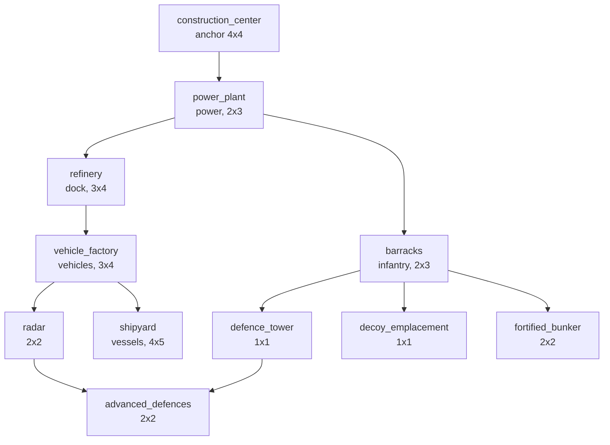

# Building definitions

Work package WP6.1 (PLAN.md phase 6). It says **what a structure is**: its footprint, the side units use, how
long it takes to build, what it costs, the power it makes or uses, what must stand before it can be built, and
what it is *for*. It does not make a structure do anything: placement is WP6.2, the build animation WP6.3,
power WP6.4, production WP6.5, repair and sell WP6.6, defences WP6.7. Each of those reads the table described
here.

All numbers are invented placeholders for the balance rounds of phase 15 (clean-room: nothing comes from
another game). The design targets that `content/units.md` states (cost, power, hit points) are used as they are.

## Where the data lives

Not a new file. A structure is a record of `assets/config/unit_defs.ron` already (WP3.1: `footprint`,
`cost`, `build_seconds`, `power`, `factions`, `hp`, `flags`), and the **permanent `kind` numbers and the
tombstones are the units' own** (`retired_units`, `docs/rules/units.md`, "Numbers are permanent"). A second
file would have meant a second id space and the same footprint, time and price written twice. What was missing
is one optional block in the same record:

```ron
(
    kind: 4, id: "vehicle_factory", factions: [Meridian, Veyran], category: Structure,
    building: (function: VehicleFactory, exit_side: PosX, requires: ["refinery"]),
    cost: 1500, build_seconds: 50, hp: 1000, armor: "structure", power: -40,
    footprint: (width: 3, height: 4), sight: 5,
    ...
),
```

A record **without** the block is a structure with no function, no exit side and no prerequisites. That is what
the frozen copies in `assets/scenarios/*_defs/` mean, so they load unchanged and are not touched (a test loads
every `*_defs` directory and checks that none has a block and that all its structures convert to
`function: None`). Every structure of the shipped file has an explicit block (a test), so a new one is a
conscious choice. Adding a structure is a new record and no Rust change (a test appends one).

## The fields

| Field | Where | Meaning |
|---|---|---|
| `footprint: (width, height)` | record | Cells, 1 to 16 each. Anchored at the cell with the smallest x and y, extending east (+x) and south (+y). |
| `building.exit_side` | block | `PosX`, `NegX`, `PosY` or `NegY`: the side of the footprint where units **come out** (a factory) or **go in** (the harvester dock). The art faces +x (`docs/conventions.md`), so every shipped structure uses `PosX`. Required for a factory or the dock, refused for any other function. The exit cell is the cell next to the middle of that side and must be usable when a factory is placed (WP6.2, "Placement"); where on that side units appear, and the free spot beyond it, is WP6.5. The structure is never rotated. |
| `build_seconds` | record | Game seconds, a whole number of 20 Hz ticks, required with a `cost`, **not negative** (refused with its own message). Becomes `build_ticks`. |
| `cost` | record | Credits; absent = cannot be built (the base anchor, mission structures). The economy of phase 7 spends it; nothing does yet. |
| `power` | record | Produced (+) or used (-). WP6.4 sums it. |
| `factions` | record | Who may **build** it: `[Meridian]`, `[Veyran]`, `[Meridian, Veyran]` or `[Neutral]`. This is the per-faction availability. Checked by `BuildStructure` only (WP6.2): a mission may place any role for any owner with `PlaceStructure`. |
| `building.requires` | block | Ids of structures the owner must have **standing** before this one can be built (the tech tree). Besides these, everything buildable has to be within the build radius of the owner's `construction_center` (WP6.2), which is not repeated in every list. |
| `building.function` | block | What it is for, below. |

### The function

An enum, `BuildingFunction` (`sf_data::units`, mirrored as `sf_sim::BuildingFunction`). Later work packages
match on it, never on an id. The numbers are permanent (they are hashed): a new function takes the next free
number, an old one is never renumbered. `the_numbers_of_functions_and_sides_are_permanent` (sf_data) and
`sim_numbers_equal_the_data_numbers_for_every_variant` (sf_bridge) pin both enums, and
`the_shipped_building_table_digest_is_pinned` pins the digest of the whole shipped table.

| # | Function | For | Needs in the record |
|---|---|---|---|
| 0 | `None` | nothing the rules act on (mission structures) | |
| 1 | `Anchor` | the base: the owner builds around it | `build_radius` flag above 0 |
| 2 | `PowerPlant` | produces power | `power` above 0 |
| 3 | `HarvesterDock` | harvesters unload here (phase 7) | `exit_side` |
| 4 | `InfantryFactory` | produces infantry (WP6.5) | `exit_side` |
| 5 | `VehicleFactory` | produces vehicles (WP6.5) | `exit_side` |
| 6 | `VesselFactory` | produces vessels (WP6.5) | `exit_side` and the `needs_water` flag |
| 7 | `Radar` | enables the minimap | the `minimap` flag |
| 8 | `Defence` | fights or shelters (WP6.7) | |
| 9 | `Decoy` | looks like another building to the enemy AI | a `disguise_as` flag |

## What loading refuses

Each message names the file and the line of the record. Every row has a test in
`crates/sf_data/tests/buildings.rs` (the simulation's own table repeats the structural ones in
`crates/sf_sim/src/buildings.rs`, so a hand-made table is checked too).

| Refused | Message contains |
|---|---|
| a prerequisite that is no record | `unknown prerequisite "x"` |
| a prerequisite that is not a Structure | `is not a Structure` |
| a prerequisite nobody can build (no cost) that is not the anchor | `can never be built` |
| a prerequisite that is not open to a faction the building is open to | `is not available to Veyran` |
| a building that needs itself, or the same prerequisite twice | `requires itself`, `listed twice` |
| a **cycle** in the tree, named with its path | `tech tree cycle in requires: a -> b -> a` |
| `requires` on something that cannot be built | `cannot be built` |
| a footprint side of 0 or above 16 | `footprint width 0 must be 1 to 16` |
| a **negative** build time (and one that is not whole ticks) | `build_seconds -15 is negative`, `whole number of ticks` |
| a factory or the dock **without an exit side** | `needs an exit_side` |
| an exit side on any other function | `exit_side NegX on a building with function Radar` |
| a function without the data it acts on | `needs power above 0`, `the minimap flag`, `the needs_water flag`, `a build_radius`, `a disguise_as` |
| a block on something that is not a Structure | `only a Structure has a building block` |
| the banned names `construction_yard` and `naval_yard` | `is a banned name` (the names are `construction_center` and `shipyard`) |
| two records with one id or one `kind`, a live record on a retired number or name | the existing checks of `units.md` |
| an unknown function, side or field | the parser's error, with line and column |

## The simulation's table

`sf_data` converts every Structure into a `SimBuildingDef` (integers: footprint, function, exit side,
`build_ticks`, price, power, faction mask, prerequisites as sorted kind numbers). `sf_bridge::building_table`
renames that into `sf_sim::BuildingTable`, and `World::with_buildings(table)` takes it once, **after
`with_units` and before anything is scheduled** (`ConfigError::BuildingsAfterStart` otherwise). Every entry has
to be a structure of the unit table with the same footprint (`ConfigError::Buildings`). `BuildingTable::new`
sorts by kind, so the order of the input is irrelevant; it refuses a duplicate kind, a footprint of zero, a
factory without a side, a side without a use, a cost without a time (or the reverse), prerequisites on
something that cannot be built, an unknown prerequisite and a cycle. Nothing is a float.

The table answers `World::building_table()`. Since WP6.2 placement reads it ("Placement" below); power (WP6.4)
and production (WP6.5) will too. `BuildingStats` has one field that is not in the data table's digest, the
`build_radius` of the anchor in whole cells (from the `build_radius` flag of the record, the fraction of a
decimal dropped); it has a digest of its own (`BuildingTable::placement_digest`) so the WP6.1 digest below stays
as it was pinned.

**Checksum.** A world given a table hashes one more section, tag `B`, after all the others: the table's digest
(every field above), since WP6.2 followed by the placement digest (the build radii) and the faction of each
player (`(player, faction bit)`, ascending by player; nothing when no faction was given). A world without a
table hashes exactly as before, so no pinned checksum of an earlier phase moved (the `golden.rs` constants and
every `assets/scenarios/*.expected` that existed before WP6.2 are unchanged: none of them is given a table).
The one new scenario, `placement`, is pinned with the section.

## Placement (WP6.2)

Where a player may build. One pure function over the world as it is when the command runs,
`World::preview_placement(kind, cell, player)`, answers with a `PlacementPreview`: the verdict for the whole
footprint, a verdict for each cell and the exit cell of a factory. `World::check_placement` is its verdict.

**The commands.** `Command::BuildStructure { kind, cell }` is the player's build: the owner is the player who
sent the command (never a field of it), the rules below are checked, and a refusal is **reported**, not dropped:
the command counts as ignored, `StepReport::placements_rejected` counts it and `World::placement_rejections()`
lists it (tick, player, kind, cell, reason) until the next step. `Command::PlaceStructure` is what it was: the
unchecked placement of scenario setup and mission objects (the sandbox, a mission's pre-placed enemy decoys).
It checks the terrain and the overlap, as it always did, and nothing else; `content/units.md` says the
decoy is "Meridian only as a buildable structure" and F1-M05 places enemy decoys as mission objects, which is
exactly this split (`f1_m05_the_player_builds_the_decoy_and_the_enemys_preplaced_decoys_stand`).

**The rules**, in the order they are reported (the first that fails is the verdict):

| Rule | Refusal | Detail |
|---|---|---|
| the kind is a structure of the unit table | `UnknownKind` | a unit, an object or a number nobody defined |
| the world has building rules | `NoBuildingRules` | no `with_buildings` |
| the structure has a price | `CannotBeBuilt` | the anchor and the mission structures have none |
| the player has a faction | `NoFaction` | `World::with_player_factions`, below |
| the structure's `factions` name it | `WrongFaction` | the faction bit of the player is in the structure's mask |
| every structure of `requires` stands for the player | `MissingPrerequisite(kind)` | the first missing one, by kind |
| every cell of the footprint is on the map | `OffMap` | the arithmetic saturates: no cell wraps round |
| every cell is buildable terrain | `BadTerrain` | the `buildable` flag of the terrain table: shipped, only grass; **water, road, rock, ore and bridge are not** |
| no cell is occupied by a structure | `Occupied` | any owner's, any size |
| no unit stands on a cell | `UnitInTheWay` | a mobile unit of the unit table whose position is in the cell; see below |
| the footprint is within reach of a base | `TooFarFromBase` | see "Proximity" |
| a factory has a usable exit cell | `ExitBlocked` | see "The exit" |

When several cells are wrong, the verdict names the worst by rank: off the map, then terrain, then a structure,
then a unit. The rules before the cells (kind, price, faction, prerequisites) come first, so the ghost of a
structure the player may not build says so instead of showing a red cell.

**Proximity.** The owner may build within `build_radius` of one of its **standing anchors** (the structures
whose function is `Anchor`; `construction_center`, radius 8). The distance is the **gap** between the two
footprints: the number of whole empty cells between the anchor's rectangle and the new one along x and along y,
the larger of the two (the chessboard distance of the rectangles; zero when they touch). A place is near when
`gap <= build_radius`. So the reach is a square round the anchor, 8 cells of free ground on each side, measured
from the anchor's own edge and to the new footprint's near edge: a 2-wide plant may start 8 cells beyond the
anchor and end 8 cells before it (`the_build_radius_reaches_exactly_eight_cells_from_every_side`). The reach
of several anchors adds up (any one will do); an enemy's anchor does not count, and neither does any other
structure (`a_structure_that_is_not_an_anchor_gives_no_reach_and_a_removed_anchor_none`). Fractions of a cell in
the data are dropped.

**Standing.** A structure stands for the prerequisites and the base when it exists in the world and has hit
points left, or has none in the table (it cannot be damaged). A structure at zero hit points does not stand
(`a_structure_at_zero_hit_points_does_not_stand_but_one_that_cannot_be_hurt_does`). There is no build state
yet: WP6.3 adds the construction animation, and until it says otherwise a structure stands from the tick it was
placed. The commands of one tick run in order, so a second build of the same tick sees the first
(`two_builds_in_one_tick_see_each_other`); "the state when the command runs", not a snapshot of the tick's
start, is the state the rule reads, and it is the same on every machine.

**Units.** Units occupy no cell in the simulation (`docs/rules/cell_overlay.md`); for placement the cell of a
mobile unit's position counts as occupied by it, so a structure is not put on top of a tank. A unit's body
radius is ignored (the crowd pass pushes bodies out of structures), and objects (a crate, an ore field) do not
block. A unit on the factory's **exit** cell does not block: it moves away.

**Factions.** `factions` restricts what a player may build, never what is placed. The simulation had no faction
per player, so the minimal data was added: `World::with_player_factions(&[(PlayerId, bit)])`, the bit being the
data's own (`Faction::bit`: Meridian 1, Veyran 2, Neutral 4; exactly one bit per player, a player listed once,
before the world starts, hashed in section `B`). A player who was given none builds nothing. The game gives its
two seats (`sandbox::faction_of_owner`) theirs in `playfield::with_buildings`; a scenario says
`factions: [(0, Meridian), (1, Veyran)]`.

**The exit.** A factory (`InfantryFactory`, `VehicleFactory`, `VesselFactory`) needs an exit cell: the cell
next to the **middle** of its `exit_side` (`exit_cell`: for `PosX`, `(x + width, y + height / 2)`; `NegX`
`(x - 1, y + height / 2)`; `PosY` `(x + width / 2, y + height)`; `NegY` `(x + width / 2, y - 1)`, the halves
rounded down). It must be on the map, free of structures and, for infantry and vehicle factories, ground every
ground class can enter (the terrain's `ground` summary, so a road is fine and water or rock are not); for the
vessel factory the terrain is not checked (which water a vessel may use is WP6.5's, it has no flag yet). One
cell, fixed, so that the ghost can show it and WP6.5 has a place to start; **where on that side and the free
spot beyond it are WP6.5's** (it will walk outwards from this cell). The harvester dock has an exit side too
but no rule yet (phase 7).

**Rotation (the WP6.1 follow-up).** A structure is **not rotated**: `BuildStructure` has no facing, the
footprint always extends east and south from its anchor and the exit side is the data's. So nothing rotates
the exit side. If rotated placement is ever added, the exit side rotates with it and `exit_cell` takes the
facing.

**Not done (gaps).** The vessel factory's `needs_water` flag is not checked (a shipyard can stand on land, since
only buildable terrain counts). A blocked exit is checked when the factory is placed, not later: a structure
put in front of an existing factory leaves it standing (WP6.5 decides what production does then). Nothing is
charged and nothing takes time (phase 7, WP6.3). `fortified_bunker` is built by a combat engineer in the field
(`content/units.md`); here it is a base structure behind the barracks, as in WP6.1.

### The ghost under the cursor (game)

`sf_game` shows the structure being placed. **B** chooses the next structure the local faction may build
(shipped: nine each, by kind; `BuildMode::for_faction`), then none; **left click** places it
(`BuildStructure` for the ghost's cell), **right click** puts it away; selecting and ordering are off while one is
chosen. `--build <role>` starts with one chosen and `--build-at x,y` pins the ghost on a cell (screenshots).
The ghost is the footprint centred on the cell under the cursor, snapped to cells.

**There are no rules in the client.** The main thread tells the sim thread which question to answer
(`SimHandle::set_ghost(GhostQuery)`, sent when the cell under the cursor changes); the sim thread asks the world
(`World::preview_placement`, the function `BuildStructure` runs) and every snapshot carries the answer
(`SimSnapshot::ghost()`); `placement_view` only paints it. The picture therefore trails the cursor by up to one
or two ticks, and a click is checked again by the simulation when it runs. The refusals of the world are
kept by the sim thread (`SimHandle::rejected_builds`) and the game says them on the console and in the line
under the top bar.

| Tint | Means |
|---|---|
| green | the place is allowed, this cell too |
| red | this cell is the problem (off the map, terrain, a structure, a unit) |
| amber | this cell is fine, but the place is refused for another reason (too far from the base, a prerequisite, the faction, the exit) |
| blue | the factory's exit cell, usable |
| red (exit) | the factory's exit cell, blocked |

The outline is green or red by the verdict. Screenshots: `docs/screenshots/wp6.2/`.

### Scenarios

`placement` (`assets/scenarios/placement.ron`, on the frozen copy `placement_defs/`, which is a copy of the shipped
definitions of WP6.2 with their building blocks, the one frozen copy that has them): two bases build with
`BuildStructure`, one command per tick, and every rule refuses something at least once. The scenario fields
`buildings: true` (the world is given the building rules of `unit_defs`), `factions: [(player, Faction)]` and the
action `BuildStructure(kind, cell)` (the issuer is the timed command's `player`) are new and optional, so no
earlier scenario changed.

## The shipped tech tree (placeholder)

Nothing is built without the `construction_center`, which each player starts with (it has no cost). Arrows
point from the prerequisite to the building. Build time and price are in `unit_defs.ron`.



| Building | Meridian | Veyran | Function | Exit | Needs (besides the anchor) | Cost | Seconds | Power |
|---|:-:|:-:|---|:-:|---|---:|---:|---:|
| construction_center | start | start | Anchor | | | | | 0 |
| power_plant | yes | yes | PowerPlant | | | 300 | 15 | +100 |
| refinery | yes | yes | HarvesterDock | +x | power_plant | 1200 | 40 | -30 |
| barracks | yes | yes | InfantryFactory | +x | power_plant | 400 | 20 | -20 |
| vehicle_factory | yes | yes | VehicleFactory | +x | refinery | 1500 | 50 | -40 |
| radar | yes | yes | Radar | | vehicle_factory | 900 | 35 | -50 |
| defence_tower | yes | yes | Defence | | barracks | 500 | 20 | -20 |
| advanced_defences | yes | yes | Defence | | defence_tower, radar | 900 | 35 | -40 |
| shipyard | yes | yes | VesselFactory | +x | vehicle_factory | 1000 | 40 | -40 |
| decoy_emplacement | **yes** | no | Decoy | | barracks | 150 | 8 | 0 |
| fortified_bunker | no | **yes** | Defence | | barracks | 600 | 25 | 0 |

The two factions share one tree and differ only in the last two rows: the Meridian decoy and the Veyran bunker
hang on the shared barracks. The decoy needs only the barracks (decision orchestrator, review of PR #69) so
that mission F1-M05, which starts with power_plant, barracks and vehicle_factory but no tower, can build it
from the start (`f1_m05_can_build_the_decoy_from_its_starting_structures`). Footprints are the art brief's. The mission structures (`relay_transmitter`,
`fuel_depot`, `archive_building`, `bridge_segment`, `rail_spur`, `automated_gun`, `generator`,
`unmanned_artillery`) are Neutral, cannot be built and have no prerequisites; `automated_gun` and
`unmanned_artillery` are `Defence`, `generator` is a `PowerPlant`, the rest `None`.

### What this tree is not

* It is **not the campaign unlock order** of `content/units.md` ("After M03: vehicle_factory", "M08:
  radar"). Which mission unlocks a role is mission data (phase 10), laid over this tree: a role must be both
  unlocked and have its prerequisites standing. The two agree: no structure is unlocked in the campaign
  before one of its prerequisites (a test holds the unlock missions of `content/units.md` against the tree).
* It carries **no unit prerequisites** (which factory a rifleman needs). That is WP6.5, which will read the
  factory functions; a unit's `requires` would be the same field.
* The edges are invented. Balance is phase 15; changing one is a data edit and a test row
  (`the_shipped_tech_tree_is_the_documented_one`) plus this table.

## Where it is tested

* `crates/sf_data/tests/buildings.rs`: the shipped tree and block per structure, the tree against the
  campaign's unlock order, the permanent numbers, every
  refusal above, the frozen copies, a record added as data, the order of the records.
* `crates/sf_sim/src/buildings.rs` (unit tests): input order, every field in the digest, every refusal, the cycle.
* `crates/sf_bridge/tests/buildings.rs`: the conversion in ticks and cells, the world taking the table at the
  right moment, an entry that does not fit the unit table, the checksum section, `PlaceStructure` unchanged.
* WP6.2: `crates/sf_sim/tests/placement.rs` (every rule, on a hand-made table), `crates/sf_sim/src/placement.rs`
  (the hit-point rule), `crates/sf_bridge/tests/placement.rs` (the shipped numbers and both factions building the
  whole tree with commands), `tools/sf_headless/tests/placement.rs` and the scenario `placement`,
  `crates/sf_game/tests/placement_ghost.rs` (the answer through the sim thread), `crates/sf_game/tests/placement_screenshot.rs`
  (the picture, through the real renderer), and the unit tests of `build_mode` and `placement_view`.
