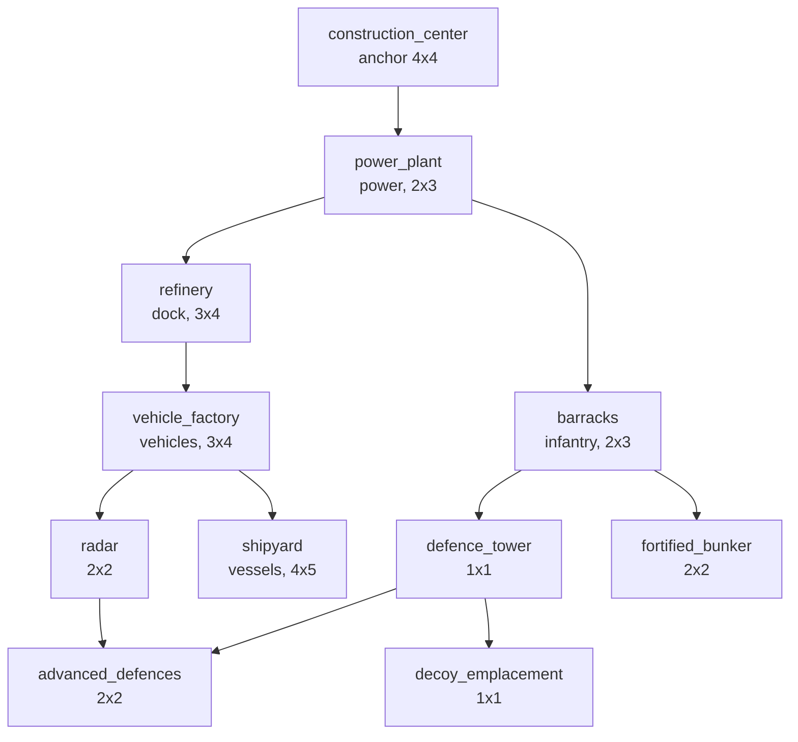

# Building definitions

Work package WP6.1 (PLAN.md phase 6). It says **what a structure is**: its footprint, the side units use, how
long it takes to build, what it costs, the power it makes or uses, what must stand before it can be built, and
what it is *for*. It does not make a structure do anything: placement is WP6.2, the build animation WP6.3,
power WP6.4, production WP6.5, repair and sell WP6.6, defences WP6.7. Each of those reads the table described
here.

All numbers are invented placeholders for the balance rounds of phase 15 (clean-room: nothing comes from
another game). The design targets that `content/units.md` states (cost, power, hit points) are used as they are.

## Where the data lives

Not a new file. A structure is a record of `assets/config/unit_defs.ron` already (WP3.1: `footprint`,
`cost`, `build_seconds`, `power`, `factions`, `hp`, `flags`), and the **permanent `kind` numbers and the
tombstones are the units' own** (`retired_units`, `docs/rules/units.md`, "Numbers are permanent"). A second
file would have meant a second id space and the same footprint, time and price written twice. What was missing
is one optional block in the same record:

```ron
(
    kind: 4, id: "vehicle_factory", factions: [Meridian, Veyran], category: Structure,
    building: (function: VehicleFactory, exit_side: PosX, requires: ["refinery"]),
    cost: 1500, build_seconds: 50, hp: 1000, armor: "structure", power: -40,
    footprint: (width: 3, height: 4), sight: 5,
    ...
),
```

A record **without** the block is a structure with no function, no exit side and no prerequisites. That is what
the frozen copies in `assets/scenarios/*_defs/` mean, so they load unchanged and are not touched (a test loads
every `*_defs` directory and checks that none has a block and that all its structures convert to
`function: None`). Every structure of the shipped file has an explicit block (a test), so a new one is a
conscious choice. Adding a structure is a new record and no Rust change (a test appends one).

## The fields

| Field | Where | Meaning |
|---|---|---|
| `footprint: (width, height)` | record | Cells, 1 to 16 each. Anchored at the cell with the smallest x and y, extending east (+x) and south (+y). |
| `building.exit_side` | block | `PosX`, `NegX`, `PosY` or `NegY`: the side of the footprint where units **come out** (a factory) or **go in** (the harvester dock). The art faces +x (`docs/conventions.md`), so every shipped structure uses `PosX`. Required for a factory or the dock, refused for any other function. Where on that side, and the free spot beyond it, is WP6.5. |
| `build_seconds` | record | Game seconds, a whole number of 20 Hz ticks, required with a `cost`, **not negative** (refused with its own message). Becomes `build_ticks`. |
| `cost` | record | Credits; absent = cannot be built (the base anchor, mission structures). The economy of phase 7 spends it; nothing does yet. |
| `power` | record | Produced (+) or used (-). WP6.4 sums it. |
| `factions` | record | Who may build it: `[Meridian]`, `[Veyran]`, `[Meridian, Veyran]` or `[Neutral]`. This is the per-faction availability. |
| `building.requires` | block | Ids of structures the owner must have **standing** before this one can be built (the tech tree). Besides these, everything buildable needs the owner's `construction_center` (WP6.2), which is not repeated in every list. |
| `building.function` | block | What it is for, below. |

### The function

An enum, `BuildingFunction` (`sf_data::units`, mirrored as `sf_sim::BuildingFunction`). Later work packages
match on it, never on an id. The numbers are permanent (they are hashed): a new function takes the next free
number, an old one is never renumbered (a test pins them).

| # | Function | For | Needs in the record |
|---|---|---|---|
| 0 | `None` | nothing the rules act on (mission structures) | |
| 1 | `Anchor` | the base: the owner builds around it | `build_radius` flag above 0 |
| 2 | `PowerPlant` | produces power | `power` above 0 |
| 3 | `HarvesterDock` | harvesters unload here (phase 7) | `exit_side` |
| 4 | `InfantryFactory` | produces infantry (WP6.5) | `exit_side` |
| 5 | `VehicleFactory` | produces vehicles (WP6.5) | `exit_side` |
| 6 | `VesselFactory` | produces vessels (WP6.5) | `exit_side` and the `needs_water` flag |
| 7 | `Radar` | enables the minimap | the `minimap` flag |
| 8 | `Defence` | fights or shelters (WP6.7) | |
| 9 | `Decoy` | looks like another building to the enemy AI | a `disguise_as` flag |

## What loading refuses

Each message names the file and the line of the record. Every row has a test in
`crates/sf_data/tests/buildings.rs` (the simulation's own table repeats the structural ones in
`crates/sf_sim/src/buildings.rs`, so a hand-made table is checked too).

| Refused | Message contains |
|---|---|
| a prerequisite that is no record | `unknown prerequisite "x"` |
| a prerequisite that is not a Structure | `is not a Structure` |
| a prerequisite nobody can build (no cost) that is not the anchor | `can never be built` |
| a prerequisite that is not open to a faction the building is open to | `is not available to Veyran` |
| a building that needs itself, or the same prerequisite twice | `requires itself`, `listed twice` |
| a **cycle** in the tree, named with its path | `tech tree cycle in requires: a -> b -> a` |
| `requires` on something that cannot be built | `cannot be built` |
| a footprint side of 0 or above 16 | `footprint width 0 must be 1 to 16` |
| a **negative** build time (and one that is not whole ticks) | `build_seconds -15 is negative`, `whole number of ticks` |
| a factory or the dock **without an exit side** | `needs an exit_side` |
| an exit side on any other function | `exit_side NegX on a building with function Radar` |
| a function without the data it acts on | `needs power above 0`, `the minimap flag`, `the needs_water flag`, `a build_radius`, `a disguise_as` |
| a block on something that is not a Structure | `only a Structure has a building block` |
| the banned names `construction_yard` and `naval_yard` | `is a banned name` (the names are `construction_center` and `shipyard`) |
| two records with one id or one `kind`, a live record on a retired number or name | the existing checks of `units.md` |
| an unknown function, side or field | the parser's error, with line and column |

## The simulation's table

`sf_data` converts every Structure into a `SimBuildingDef` (integers: footprint, function, exit side,
`build_ticks`, price, power, faction mask, prerequisites as sorted kind numbers). `sf_bridge::building_table`
renames that into `sf_sim::BuildingTable`, and `World::with_buildings(table)` takes it once, **after
`with_units` and before anything is scheduled** (`ConfigError::BuildingsAfterStart` otherwise). Every entry has
to be a structure of the unit table with the same footprint (`ConfigError::Buildings`). `BuildingTable::new`
sorts by kind, so the order of the input is irrelevant; it refuses a duplicate kind, a footprint of zero, a
factory without a side, a side without a use, a cost without a time (or the reverse), prerequisites on
something that cannot be built, an unknown prerequisite and a cycle. Nothing is a float.

**No behaviour yet.** The world only stores the table and answers `World::building_table()`. A
`PlaceStructure` is exactly what it was.

**Checksum.** A world given a table hashes one more section, tag `B`, after all the others: the table's digest
(every field above). A world without a table hashes exactly as before, so no pinned checksum of an earlier
phase moved (the `golden.rs` constants and every `assets/scenarios/*.expected` are unchanged: no scenario is
given a table). The game and the headless runner are not wired to it yet; WP6.2 will do that together with
the first rule that reads it, and the scenarios of that WP will be pinned with the section.

## The shipped tech tree (placeholder)

Nothing is built without the `construction_center`, which each player starts with (it has no cost). Arrows
point from the prerequisite to the building. Build time and price are in `unit_defs.ron`.



| Building | Meridian | Veyran | Function | Exit | Needs (besides the anchor) | Cost | Seconds | Power |
|---|:-:|:-:|---|:-:|---|---:|---:|---:|
| construction_center | start | start | Anchor | | | | | 0 |
| power_plant | yes | yes | PowerPlant | | | 300 | 15 | +100 |
| refinery | yes | yes | HarvesterDock | +x | power_plant | 1200 | 40 | -30 |
| barracks | yes | yes | InfantryFactory | +x | power_plant | 400 | 20 | -20 |
| vehicle_factory | yes | yes | VehicleFactory | +x | refinery | 1500 | 50 | -40 |
| radar | yes | yes | Radar | | vehicle_factory | 900 | 35 | -50 |
| defence_tower | yes | yes | Defence | | barracks | 500 | 20 | -20 |
| advanced_defences | yes | yes | Defence | | defence_tower, radar | 900 | 35 | -40 |
| shipyard | yes | yes | VesselFactory | +x | vehicle_factory | 1000 | 40 | -40 |
| decoy_emplacement | **yes** | no | Decoy | | defence_tower | 150 | 8 | 0 |
| fortified_bunker | no | **yes** | Defence | | barracks | 600 | 25 | 0 |

The two factions share one tree and differ only in the last two rows: the Meridian decoy and the Veyran bunker
hang on the shared defences. Footprints are the art brief's. The mission structures (`relay_transmitter`,
`fuel_depot`, `archive_building`, `bridge_segment`, `rail_spur`, `automated_gun`, `generator`,
`unmanned_artillery`) are Neutral, cannot be built and have no prerequisites; `automated_gun` and
`unmanned_artillery` are `Defence`, `generator` is a `PowerPlant`, the rest `None`.

### What this tree is not

* It is **not the campaign unlock order** of `content/units.md` ("After M03: vehicle_factory", "M08:
  radar"). Which mission unlocks a role is mission data (phase 10), laid over this tree: a role must be both
  unlocked and have its prerequisites standing. The two agree: no structure is unlocked in the campaign
  before one of its prerequisites (a test holds the unlock missions of `content/units.md` against the tree).
* It carries **no unit prerequisites** (which factory a rifleman needs). That is WP6.5, which will read the
  factory functions; a unit's `requires` would be the same field.
* The edges are invented. Balance is phase 15; changing one is a data edit and a test row
  (`the_shipped_tech_tree_is_the_documented_one`) plus this table.

## Where it is tested

* `crates/sf_data/tests/buildings.rs`: the shipped tree and block per structure, the tree against the
  campaign's unlock order, the permanent numbers, every
  refusal above, the frozen copies, a record added as data, the order of the records.
* `crates/sf_sim/src/buildings.rs` (unit tests): input order, every field in the digest, every refusal, the cycle.
* `crates/sf_bridge/tests/buildings.rs`: the conversion in ticks and cells, the world taking the table at the
  right moment, an entry that does not fit the unit table, the checksum section, `PlaceStructure` unchanged.
